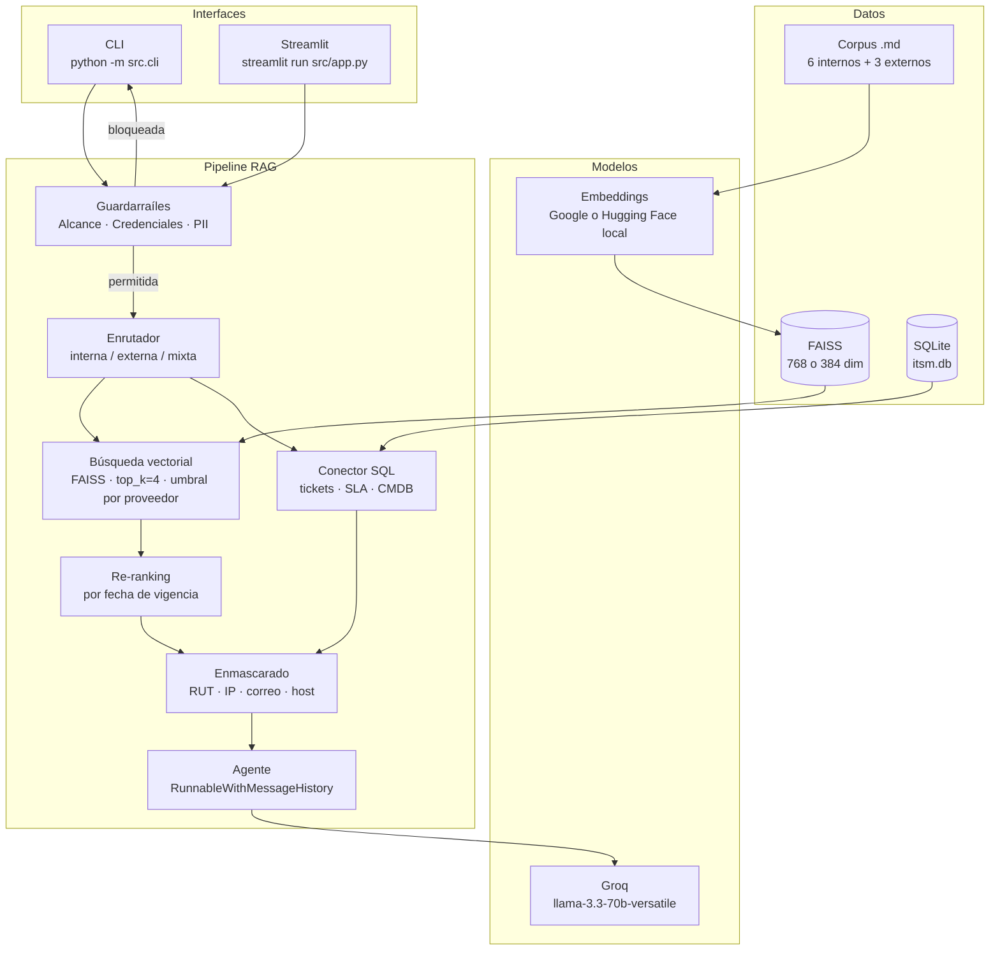

# Asistente RAG para Mesa de Ayuda TI — Aconcagua Logística SpA

> **EP1 y EP2 · ISY0101 Ingeniería de Soluciones con IA — Duoc UC**

Asistente conversacional con **Retrieval-Augmented Generation (RAG)** que apoya a los agentes de Nivel 1 de la mesa de ayuda de TI de Aconcagua Logística SpA, una empresa chilena de transporte y distribución con 450 colaboradores, 5 sucursales y un centro de distribución.

El sistema recupera el procedimiento aplicable a cada consulta desde la base documental interna y externa, complementa con datos del ITSM vía SQL, y entrega al agente una respuesta con pasos numerados, diagnóstico probable, tiempo comprometido según el SLA, criterio de escalamiento y cita de la fuente.

## Agente EP2 — Etapa 4

La continuación EP2 incorpora una CLI independiente con LangChain Agents y
Groq `openai/gpt-oss-20b`. El modelo selecciona entre seis herramientas:
`consultar_ticket`, `consultar_sla`, `consultar_activo`, `buscar_procedimiento`,
`analizar_incidente` y `registrar_nota_ticket`. La última prepara una vista previa
y pausa: solo el campo humano `CONFIRMAR` autoriza una escritura en SQLite EP2.
El ITSM original se consulta en modo solo lectura.

La [instalación y ejecución EP2](#instalación-y-ejecución-ep2) está separada de
los [comandos EP1](#ejecución-ep1). La interfaz Streamlit existente corresponde
a EP1; los flujos de herramientas, memoria y planificación EP2 se muestran en su CLI.

`EP2_LLM_MODEL` configura el modelo EP2; `LLM_MODEL` conserva el modelo EP1.
Los límites predeterminados son 8 iteraciones, 90 segundos por ciclo y 30 segundos
por petición al LLM; se configuran con las variables EP2 de `.env.example`.
No sobrescribir un `.env` existente. Las interfaces EP1 y los embeddings
Hugging Face/Google se conservan. Esta CLI local no autentica usuarios. Persiste
intercambios resumidos, hechos con procedencia y estado de tarea en SQLite EP2,
separados por usuario, sesión y perfil. Para continuar tras `/salir`, ejecutar
de nuevo con los mismos identificadores. Conserva seis intercambios y hasta 32
hechos por contexto, con retención de 30 días y límites configurables.
Las autorizaciones de escritura no se restauran. El agente incorpora un plan
validado con prioridades, dependencias y estados, actualizado por resultados
reales. La CLI muestra plan inicial, observaciones, cambios y resultado final.
Un nuevo reporte de impacto reabre verificaciones y separa prioridad registrada
de propuesta. `POSPONER` conserva una nota pendiente sin escribirla; al reabrir
se necesita una nueva vista previa y confirmación. La entrega académica final de
Etapa 5 permanece pendiente.
La **Etapa 4 queda cerrada técnicamente** con **584 pruebas automatizadas** y una
evaluación integral real aprobada **15/15 en una misma ejecución**, el 22 de
octubre de 2026: inicial, impacto y reanudar; **10 solicitudes HTTP 200** y
**18.137 tokens informados por Groq**. Se verificaron memoria/plan entre procesos,
dependencias, confirmación humana, cero escrituras de negocio e ITSM intacto.
La proyección por paso reduce el contexto enviado sin reducir la persistencia.
El HTTP 400 histórico no se reprodujo en esta ejecución; su causa histórica no
quedó demostrada. Los ensayos aislados y los intentos parciales anteriores se
conservan como antecedentes, separados de esta aceptación integral.

Ver [arquitectura EP2](docs/arquitectura.md#arquitectura-ep2),
[bocetos EP2](docs/bocetos/ep2.md),
[matriz de trazabilidad IE1–IE10](docs/trazabilidad_ep2.md),
[planificación y ejecución EP2 actual](docs/ep2_etapa4.md),
[evidencia sanitizada del cierre 15/15](docs/evidencias/ep2_etapa4_cierre_tecnico.md),
[antecedentes históricos del plan adaptativo](docs/evidencias/ep2_plan_real.md),
[memoria persistente](docs/ep2_etapa3.md),
[arquitectura de herramientas](docs/ep2_etapa2.md),
[controles transaccionales de Etapa 1](docs/ep2_etapa1.md) y
[evidencia de continuidad real](docs/evidencias/ep2_memoria_real.md).

---

## Arquitectura EP1



---

## Requisitos previos

- **Python 3.11 o superior** instalado y en el PATH.
- **API key de Groq**; la de Google solo se requiere al usar embeddings de Google.
- Conexión a Internet para Groq, Google si se selecciona, y la primera descarga del modelo local.

---

## Cómo obtener las API keys

| Proveedor | Modelo | Variable | Cómo obtenerla |
|---|---|---|---|
| **Groq** | EP2: `openai/gpt-oss-20b`; EP1: según `LLM_MODEL` | `LLM_API_KEY` | Crear una clave en [console.groq.com](https://console.groq.com/keys). Comprobar modelos accesibles y cuota de la cuenta antes de una ejecución real. |
| **Google AI Studio** | `gemini-embedding-001` | `GOOGLE_API_KEY` | Crear una clave en [AI Studio](https://aistudio.google.com/app/apikey), solo si se selecciona Google para embeddings. |

---

## Instalación y ejecución EP2

Ejecutar desde la raíz del proyecto. La instalación descarga dependencias;
la primera carga de Hugging Face puede descargar el modelo. La CLI y los
evaluadores reales requieren conexión a Groq y consumen cuota.

### 1. Clonar y preparar Python

En PowerShell, para una instalación nueva:

```powershell
git clone https://github.com/sebacvdo-prog/mesa-ayuda-ti-rag.git
Set-Location mesa-ayuda-ti-rag
python -m venv .venv
.\.venv\Scripts\Activate.ps1
python -m pip install -r requirements.txt
```

En Linux/macOS, activar el entorno con `source .venv/bin/activate`.
Si el repositorio y `.venv` ya existen, usar ese directorio y entorno.
Las versiones de las ejecuciones históricas están en sus evidencias; los rangos
de `requirements.txt` no bloquean las versiones de todo el entorno.

### 2. Configurar el entorno

Crear `.env` únicamente si no existe:

```powershell
if (-not (Test-Path -LiteralPath .env)) {
    Copy-Item -LiteralPath .env.example -Destination .env
}
```

Editar `.env` para establecer una `LLM_API_KEY` válida y conservar
`LLM_BASE_URL=https://api.groq.com/openai/v1`. La plantilla selecciona:

```dotenv
EP2_LLM_MODEL=openai/gpt-oss-20b
EP2_MAX_ITERATIONS=8
EP2_MAX_SECONDS=90
EP2_LLM_TIMEOUT=30
EMBEDDING_PROVIDER=huggingface
EMBEDDING_MODEL=sentence-transformers/all-MiniLM-L6-v2
EMBEDDING_DIM=384
HF_SIMILARITY_THRESHOLD=0.471764
```

`LLM_MODEL` configura EP1 y no sustituye `EP2_LLM_MODEL`. Con Hugging Face no
se necesita una clave de Google. Para Google, usar las variables alternativas
de `.env.example` y `GOOGLE_API_KEY`. No sobrescribir un `.env` existente ni
publicar claves, SQLite, índices o cachés.

### 3. Preparar datos e índice solo cuando falten

En una instalación nueva, inicializar los artefactos ausentes:

```powershell
if (-not (Test-Path -LiteralPath data/itsm.db)) {
    python data/seed_db.py
}
if (-not (Test-Path -LiteralPath storage/faiss_index/index.faiss)) {
    python -m src.ingest
}
```

`seed_db.py` recrea las tablas del ITSM: no repetirlo sobre una base existente
para una demo. La ingesta genera archivos y puede descargar el modelo local o
llamar a Google, según el proveedor. Un índice existente debe corresponder al
proveedor, modelo y dimensión configurados; el cargador rechaza incompatibilidades.
Un cambio de configuración requiere la reconstrucción descrita más abajo,
no volver a poblar la base de datos. SQLite EP2 se inicializa al abrir la CLI.

### 4. Abrir y continuar la CLI EP2

```powershell
python -m src.ep2.cli --usuario agente_demo --sesion sesion_demo --perfil agente
```

`/salir` termina. Para recuperar memoria y plan, volver a ejecutar el mismo
comando con el mismo usuario, sesión y perfil. `--perfil usuario_final` permite
comprobar restricciones, pero esta CLI local no autentica identidades.

La propuesta de nota muestra una vista previa y un campo humano independiente:
`CONFIRMAR` registra la nota en SQLite EP2; `POSPONER` conserva el pendiente
sin registrar la nota; otra entrada cancela. Una frase de confirmación en el chat
no autoriza escrituras. Tras reiniciar se requiere una nueva vista previa.
Ver el [guion de consulta, adaptación y posposición](docs/bocetos/ep2.md).

### 5. Comprobaciones automatizadas y evaluadores EP2

Las pruebas automatizadas usan dobles del modelo/HTTP y bases temporales:

```powershell
python -m pytest -q
python -m pip check
```

Los siguientes comandos son evaluaciones **reales**, no forman parte de esa
suite y deben ejecutarse separadamente con autorización y cuota disponibles:

| Comando | Alcance y requisitos |
|---|---|
| `python -m eval.check_ep2_agent --offline-embeddings` | Cuatro casos de herramientas con Groq e índice FAISS existente. El modo offline afecta a Hugging Face y requiere su modelo descargado; Groq sigue usando red. |
| `python -m eval.check_ep2_memory` | Continuidad con Groq entre dos procesos nuevos; fija el modo offline de Hugging Face y usa SQLite EP2 temporal. |
| `python -m eval.check_ep2_plan` | Tres procesos CLI: inicial, impacto y reanudar. Usa Groq y FAISS reales, SQLite EP2 temporal y `POSPONER` guionado. |

Los tres verificadores conservan reportes bajo `.cache/`, no confirman notas
y comprueban que el ITSM permanezca intacto. La memoria interna sí se actualiza.

| Ejecución | Límites predeterminados |
|---|---|
| CLI EP2 y agente usado en los verificadores de herramientas/memoria | 8 iteraciones, 90 s cooperativos por consulta y 30 s de timeout LLM; configurables mediante variables EP2. El verificador de memoria limita además cada proceso hijo a 180 s. |
| Evaluador integral `check_ep2_plan` | 300 s por fase, 360 s por proceso y 30 s de timeout HTTP; 14 solicitudes y 80.000 tokens operativos globales; máximo 2.000 tokens de salida; intervalo de 35 s y pausas entre fases de 60 s. Conserva el límite de iteraciones EP2, 8 por defecto. |

El evaluador integral permite configurar esos controles mediante argumentos
descritos en [Etapa 4](docs/ep2_etapa4.md#validación-evidencia-e-indicadores).
No cambia los 90 s predeterminados de la CLI ni el `.env`. El tiempo del agente
es cooperativo, no una interrupción estricta de operaciones síncronas.

## Ejecución EP1

EP1 reutiliza la instalación, los datos y el índice anteriores. Su modelo se
selecciona con `LLM_MODEL`; comprobar disponibilidad antes de usarlo. Sus entradas
son distintas de la CLI EP2:

```powershell
python -m src.cli
streamlit run src/app.py
```

Evaluación EP1 con LLM juez, que llama al proveedor y escribe una corrida nueva:

```powershell
python -m eval.evaluate --limite 5 --perfil agente --pausa 6
```

Es un ejemplo de invocación admitida, no el registro del comando original de
septiembre. Ejecutarlo con la configuración actual no reproduce necesariamente
los valores históricos y no evalúa el agente EP2.

---

## Variables de entorno

| Variable | Obligatoria | Descripción | Valor por defecto |
|---|---|---|---|
| `LLM_API_KEY` | Sí | Clave de API de Groq | — |
| `LLM_BASE_URL` | No | Endpoint compatible con OpenAI | `https://api.groq.com/openai/v1` |
| `LLM_MODEL` | No | Modelo de chat | `llama-3.3-70b-versatile` |
| `EP2_LLM_MODEL` | No | Modelo del agente EP2 | `openai/gpt-oss-20b` |
| `EP2_MAX_ITERATIONS` | No | Iteraciones por consulta EP2 | `8` |
| `EP2_MAX_SECONDS` | No | Tiempo cooperativo por consulta EP2 | `90` |
| `EP2_LLM_TIMEOUT` | No | Timeout por petición LLM EP2 | `30` |
| `GOOGLE_API_KEY` | Solo con Google | Clave de Google AI Studio | — |
| `EMBEDDING_PROVIDER` | No | `google` o `huggingface` | `google` (`.env.example` selecciona `huggingface`) |
| `EMBEDDING_MODEL` | No | Modelo de embeddings | Google: `models/gemini-embedding-001`; local: `sentence-transformers/all-MiniLM-L6-v2` |
| `EMBEDDING_DIM` | No | Dimensiones del vector | Google: `768`; local: `384` |
| `HF_SIMILARITY_THRESHOLD` | No | Umbral de recuperación local entre 0 y 1; Google conserva `0.72` | `0.471764` |
| `LANGCHAIN_TRACING_V2` | No | Activa LangSmith | `false` |
| `LANGCHAIN_API_KEY` | No | Clave de LangSmith | — |
| `LANGCHAIN_PROJECT` | No | Proyecto en LangSmith | `mesa-ayuda-ti-rag` |
| `LANGCHAIN_ENDPOINT` | No | Endpoint de LangSmith | `https://api.smith.langchain.com` |

Los límites de memoria `EP2_MEMORY_*` están en `.env.example` y en
[Etapa 3](docs/ep2_etapa3.md#límites-y-recuperación-ante-errores).

Para usar embeddings locales, definí `EMBEDDING_PROVIDER=huggingface`,
`EMBEDDING_MODEL=sentence-transformers/all-MiniLM-L6-v2` y `EMBEDDING_DIM=384`.
El modelo se ejecuta en CPU, con vectores normalizados y sin clave de Google.
Para volver a la alternativa original, usá `google`, `models/gemini-embedding-001`
y `768`, con una `GOOGLE_API_KEY` válida. La configuración de Groq no cambia.

Después de cambiar proveedor, modelo o dimensión, ejecutá `python -m src.ingest`.
La caché distingue cada configuración y FAISS rechaza índices incompatibles o
antiguos sin metadatos. La reconstrucción guarda primero el índice nuevo y
conserva el anterior en `storage/faiss_index-respaldo-*`; no elimina el corpus,
la caché ni la base ITSM. `storage/`, `.cache/` y `.env` están excluidos de Git.

El umbral original de Google (`0.72`) se conserva. Para Hugging Face se usa
`HF_SIMILARITY_THRESHOLD=0.471764`, calibrado para `all-MiniLM-L6-v2` con el
dataset existente. Cambiar el umbral no requiere reconstruir el índice ni la caché.
Los scores de esta versión de LangChain son `1 - distancia_L2_cuadrada / sqrt(2)`;
no representan probabilidad ni coseno. La calibración conserva esa escala.

Para reproducir el barrido completo sin Groq ni LLM juez:

```bash
python -m eval.calibrate_retrieval --offline
```

El comando compara todos los intervalos definidos por los scores, exige rechazo
de los casos sin fuente, maximiza aciertos de fuente@4 y desempata por precisión
documental proxy. Escribe el informe y la curva en `.cache/calibracion-huggingface.md`
y `.json`. La precisión documental mide coincidencia de archivo, no relevancia
de cada fragmento. Los resultados y límites están en
[la evidencia de calibración](docs/evidencias/calibracion_embeddings_locales.md).
Si se cambia el modelo o el corpus, hay que repetir esta evaluación.

---

## Evaluación histórica EP1 y validación EP2

La afirmación anterior de **fidelidad 0,880 en diez casos no está verificada**:
no se localizó una corrida versionada que respalde esa cifra o ese tamaño de
muestra. No se utiliza como resultado acreditado ni se alteran los originales.

La corrida EP1 respaldada es
[`evaluacion-20260907-013833.json`](eval/resultados/evaluacion-20260907-013833.json),
con [resumen original](eval/resultados/evaluacion-20260907-013833.md) y
[copia documental](docs/evidencias/evaluacion_resultados.md). Registra el
7 de septiembre de 2026 a las 01:38:33, sin zona horaria almacenada,
cinco casos KB-01–KB-05 del dataset 1.0.0 y perfil `agente`.

| Métrica histórica EP1 | Resultado registrado |
|---|---:|
| Fidelidad | 0,360 |
| Relevancia de la respuesta | 0,940 |
| Precisión del contexto | 0,990 |
| Acierto de fuente | 5/5 |

Configuración registrada: chat y juez `openai/gpt-oss-120b`, temperaturas
0,1/0,0; Google `models/gemini-embedding-001`, 768 dimensiones; chunks 900/150,
`top_k=4`, umbral 0,72 y prompts 1.0.0. El comando exacto no quedó registrado.
Las otras cuatro corridas versionadas repiten KB-01; no amplían esta muestra a
diez casos independientes. Ver la [procedencia de las cifras](docs/evidencias/README.md#procedencia-de-las-métricas-históricas-ep1).

**Estos valores no representan el rendimiento actual de EP2.** El cierre EP2
acredita 15/15 comprobaciones funcionales de un flujo con Groq real; no mide una
fidelidad semántica global. Sus 584 pruebas automatizadas son validación local,
no 584 llamadas reales. La [calibración local](docs/evidencias/calibracion_embeddings_locales.md)
midió recuperación de fuente con Hugging Face: 11/19, o 10/19 al excluir cada
pregunta de su propia calibración; no puntúa respuestas generadas.

---

## Estructura de carpetas

```
mesa-ayuda-ti-rag/
├─ README.md                        # Este archivo
├─ requirements.txt                 # Dependencias del proyecto
├─ .env.example                     # Plantilla de variables de entorno
├─ .gitignore                       # Archivos excluidos del repositorio
├─ conftest.py                      # Configuración de pytest
├─ src/
│  ├─ __init__.py
│  ├─ config.py                     # Carga de env, constantes, fábricas, caché, backoff
│  ├─ ingest.py                     # Pipeline de ingesta → índice FAISS
│  ├─ retriever.py                  # Retriever vectorial + SQL + enrutador + re-ranking
│  ├─ prompts.py                    # P1, P2, P3 como constantes versionadas
│  ├─ guardrails.py                 # Enmascarado PII/IP/host + perfiles + política
│  ├─ memory.py                     # Ventana de 6 turnos + resumen de sesión
│  ├─ agent.py                      # Cadena principal (RunnableWithMessageHistory)
│  ├─ cli.py                        # Interfaz de consola
│  ├─ app.py                        # Interfaz Streamlit EP1
│  └─ ep2/
│     ├─ __init__.py
│     ├─ agente.py                  # AgentExecutor, oferta y validación de herramientas
│     ├─ configuracion.py           # Modelo y límites exclusivos de EP2
│     ├─ cli.py                     # CLI, trazabilidad y confirmación humana
│     ├─ contratos.py               # Entradas, resultados y grafo del plan
│     ├─ herramientas.py            # Lecturas, triage y propuestas de notas
│     ├─ almacenamiento.py          # Notas y auditoría transaccionales
│     ├─ memoria.py                  # Snapshot persistente de contexto y plan
│     ├─ planificacion.py            # Prioridades, dependencias y adaptación
│     └─ contexto.py                 # Proyección de solo lectura por decisión
├─ data/
│  ├─ internos/                     # 6 documentos .md del corpus interno
│  ├─ externos/                     # 3 documentos .md de proveedores y CSIRT
│  ├─ seed_db.py                    # Crea y puebla itsm.db
│  └─ evaluacion/
│     └─ dataset.json               # 20 preguntas con respuesta de referencia
├─ eval/
│  ├─ __init__.py
│  ├─ evaluate.py                   # Evaluación EP1 con LLM juez
│  ├─ calibrate_retrieval.py         # Recuperación local, sin Groq ni juez
│  ├─ check_groq_tools.py            # Compatibilidad real mínima de herramientas
│  ├─ check_ep2_agent.py             # Integración real de seis herramientas
│  ├─ check_ep2_memory.py            # Continuidad real entre procesos
│  ├─ check_ep2_plan.py              # Integral real y controles diagnósticos
│  └─ resultados/                   # Corridas históricas EP1 .json y .md
├─ docs/
│  ├─ arquitectura.md               # Arquitectura EP1 y diagrama vigente EP2
│  ├─ pipeline.md                   # Decisiones de chunking, embeddings, top_k, umbral
│  ├─ prompts.md                    # Los 3 prompts y su justificación
│  ├─ ep2_etapa1.md                 # Contratos, permisos y transacciones
│  ├─ ep2_etapa2.md                 # Agente y herramientas
│  ├─ ep2_etapa3.md                 # Memoria persistente
│  ├─ ep2_etapa4.md                 # Planificación, proyección y cierre técnico
│  ├─ trazabilidad_ep2.md           # Matriz IE1–IE10, pruebas y pendientes
│  ├─ bocetos/
│  │  ├─ README.md                  # Bocetos históricos EP1 y enlace EP2
│  │  └─ ep2.md                     # Consulta, replanificación y confirmación
│  └─ evidencias/                   # Índice, logs y resultados documentados
└─ tests/                          # Pruebas EP1, EP2, embeddings y evaluadores
```

---

## Limitaciones conocidas

1. **Disponibilidad y cuota del proveedor.** Dependen de la cuenta y del modelo. EP1 incorpora backoff ante errores de cuota; EP2 desactiva los reintentos automáticos del cliente LLM. La evaluación integral aplica presupuestos y detención ante errores. La caché de embeddings evita cálculos repetidos.
2. **Datos ficticios.** Los RUT, correos, IP y tickets son simulados. Los RUT usan números del tramo 30.000.000+ (no asignado en Chile) con dígito verificador válido.
3. **Sin conexión a plataformas reales.** La base de datos SQLite reemplaza al ITSM y la CMDB; no se conecta a ServiceNow, Jira ni ningún sistema productivo.
4. **Alcance de acciones.** EP1 solo consulta y responde: no cierra tickets, restablece contraseñas ni modifica el directorio. EP2 incorpora herramientas de lectura y propuestas de notas; una nota solo se registra mediante confirmación humana explícita en SQLite EP2.
5. **Enrutador por heurística de palabras clave.** La clasificación interna/externa/mixta es deliberadamente simple. Una clasificación equivocada solo cambia el filtro de fuente; `mixta` nunca deja fuera documentos.
6. **Idioma fijo.** El corpus, los prompts y las interfaces están en español de Chile. No se soporta multiidioma.
7. **Memoria.** En EP1 el historial vive en el proceso y se pierde al reiniciar. EP2 persiste memoria y plan en SQLite por usuario, sesión y perfil, sin restaurar autorizaciones de escritura.
8. **LangSmith opcional.** La trazabilidad con LangSmith está disponible pero no es obligatoria. El sistema funciona igual sin ella.

---

## Licencia

Proyecto académico de evaluación. Uso exclusivo para la asignatura ISY0101 de Duoc UC.
