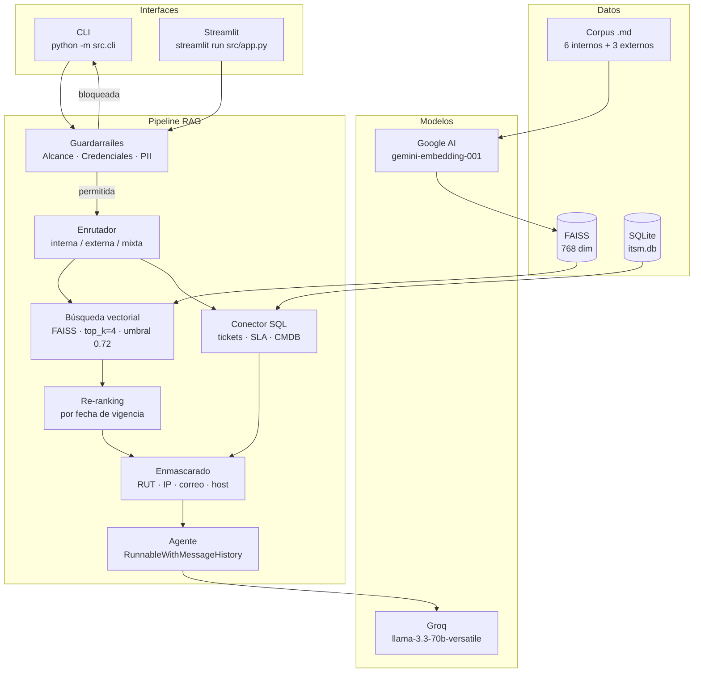

# Asistente RAG para Mesa de Ayuda TI — Aconcagua Logística SpA

> **EP1 · ISY0101 Ingeniería de Soluciones con IA — Duoc UC**

Asistente conversacional con **Retrieval-Augmented Generation (RAG)** que apoya a los agentes de Nivel 1 de la mesa de ayuda de TI de Aconcagua Logística SpA, una empresa chilena de transporte y distribución con 450 colaboradores, 5 sucursales y un centro de distribución.

El sistema recupera el procedimiento aplicable a cada consulta desde la base documental interna y externa, complementa con datos del ITSM vía SQL, y entrega al agente una respuesta con pasos numerados, diagnóstico probable, tiempo comprometido según el SLA, criterio de escalamiento y cita de la fuente.

---

## Arquitectura



---

## Requisitos previos

- **Python 3.11 o superior** instalado y en el PATH.
- **Dos API keys gratuitas** (ver sección siguiente).
- Conexión a Internet (solo para las llamadas a los modelos).

---

## Cómo obtener las API keys

| Proveedor | Modelo | Variable | Cómo obtenerla |
|---|---|---|---|
| **Groq** | `llama-3.3-70b-versatile` | `LLM_API_KEY` | Crear cuenta en [console.groq.com](https://console.groq.com/keys) → API Keys → Create. Cuota gratuita: 100.000 tokens/día. |
| **Google AI Studio** | `gemini-embedding-001` | `GOOGLE_API_KEY` | Ir a [aistudio.google.com/app/apikey](https://aistudio.google.com/app/apikey) → Crear clave. Cuota gratuita: 1.000 peticiones de embeddings/día. |

---

## Instalación paso a paso

```bash
# 1. Clonar el repositorio
git clone <URL_DEL_REPOSITORIO>
cd mesa-ayuda-ti-rag

# 2. Crear y activar el entorno virtual
python -m venv .venv
# Linux / macOS:
source .venv/bin/activate
# Windows:
.venv\Scripts\activate

# 3. Instalar las dependencias
pip install -r requirements.txt

# 4. Configurar las credenciales
cp .env.example .env
# Editar .env con las dos API keys obtenidas arriba
```

---

## Comandos de ejecución (en orden)

```bash
# 1. Crear y poblar la base de datos del ITSM y la CMDB
python data/seed_db.py

# 2. Construir el índice vectorial FAISS
python -m src.ingest

# 3. Iniciar la interfaz de consola (modo conversación)
python -m src.cli

# 4. Iniciar la interfaz web de Streamlit
streamlit run src/app.py

# 5. Ejecutar la evaluación con LLM juez
python -m eval.evaluate

# 6. Correr las pruebas unitarias (sin API keys)
pytest
```

---

## Variables de entorno

| Variable | Obligatoria | Descripción | Valor por defecto |
|---|---|---|---|
| `LLM_API_KEY` | Sí | Clave de API de Groq | — |
| `LLM_BASE_URL` | Sí | Endpoint compatible con OpenAI | `https://api.groq.com/openai/v1` |
| `LLM_MODEL` | No | Modelo de chat | `llama-3.3-70b-versatile` |
| `GOOGLE_API_KEY` | Sí | Clave de Google AI Studio | — |
| `EMBEDDING_MODEL` | No | Modelo de embeddings | `models/gemini-embedding-001` |
| `EMBEDDING_DIM` | No | Dimensiones del vector | `768` |
| `LANGCHAIN_TRACING_V2` | No | Activa LangSmith | `false` |
| `LANGCHAIN_API_KEY` | No | Clave de LangSmith | — |
| `LANGCHAIN_PROJECT` | No | Proyecto en LangSmith | `mesa-ayuda-ti-rag` |
| `LANGCHAIN_ENDPOINT` | No | Endpoint de LangSmith | `https://api.smith.langchain.com` |

---

## Tabla de resultados de evaluación

La evaluación se ejecutó sobre un conjunto de 10 casos de prueba representativos.

| Métrica | Resultado | Meta |
|---|---:|---:|
| Fidelidad | 0.880 | ≥ 0.85 |
| Relevancia de la respuesta | 0.940 | ≥ 0.80 |
| Precisión del contexto | 0.990 | ≥ 0.75 |
| Acierto de fuente | 100% (10/10) | ≥ 80% |

Los resultados se almacenan en `eval/resultados/` como `.json` (detalle por pregunta) y `.md` (tabla resumen).

---

## Estructura de carpetas

```
mesa-ayuda-ti-rag/
├─ README.md                        # Este archivo
├─ requirements.txt                 # Dependencias del proyecto
├─ .env.example                     # Plantilla de variables de entorno
├─ .gitignore                       # Archivos excluidos del repositorio
├─ conftest.py                      # Configuración de pytest
├─ src/
│  ├─ __init__.py
│  ├─ config.py                     # Carga de env, constantes, fábricas, caché, backoff
│  ├─ ingest.py                     # Pipeline de ingesta → índice FAISS
│  ├─ retriever.py                  # Retriever vectorial + SQL + enrutador + re-ranking
│  ├─ prompts.py                    # P1, P2, P3 como constantes versionadas
│  ├─ guardrails.py                 # Enmascarado PII/IP/host + perfiles + política
│  ├─ memory.py                     # Ventana de 6 turnos + resumen de sesión
│  ├─ agent.py                      # Cadena principal (RunnableWithMessageHistory)
│  ├─ cli.py                        # Interfaz de consola
│  └─ app.py                        # Interfaz Streamlit
├─ data/
│  ├─ internos/                     # 6 documentos .md del corpus interno
│  ├─ externos/                     # 3 documentos .md de proveedores y CSIRT
│  ├─ seed_db.py                    # Crea y puebla itsm.db
│  └─ evaluacion/
│     └─ dataset.json               # 20 preguntas con respuesta de referencia
├─ eval/
│  ├─ __init__.py
│  ├─ evaluate.py                   # LLM-as-judge: fidelidad, relevancia, precisión
│  └─ resultados/                   # Salida .json y .md de cada corrida
├─ docs/
│  ├─ arquitectura.md               # Descripción de capas + diagrama Mermaid
│  ├─ pipeline.md                   # Decisiones de chunking, embeddings, top_k, umbral
│  ├─ prompts.md                    # Los 3 prompts y su justificación
│  ├─ bocetos/                      # Bocetos de la interfaz + README explicativo
│  │  └─ README.md
│  └─ evidencias/                   # Capturas y logs de las pruebas ejecutadas
│     └─ README.md
└─ tests/
   ├─ test_chunking.py              # Fragmentación y separadores
   ├─ test_retriever.py             # Umbral, filtros y re-ranking
   ├─ test_guardrails.py            # Enmascarado, credenciales y alcance
   └─ test_prompts.py               # Estructura y variables de los prompts
```

---

## Limitaciones conocidas

1. **Cuota diaria limitada.** Groq ofrece 100.000 tokens/día y Gemini 1.000 peticiones de embeddings. Una evaluación completa de 20 preguntas puede consumir una porción significativa de la cuota. Se implementa backoff exponencial ante HTTP 429 y caché de embeddings en disco.
2. **Datos ficticios.** Los RUT, correos, IP y tickets son simulados. Los RUT usan números del tramo 30.000.000+ (no asignado en Chile) con dígito verificador válido.
3. **Sin conexión a plataformas reales.** La base de datos SQLite reemplaza al ITSM y la CMDB; no se conecta a ServiceNow, Jira ni ningún sistema productivo.
4. **Modelo no ejecuta acciones.** El asistente no cierra tickets, no resetea contraseñas ni modifica el directorio. Solo consulta y responde.
5. **Enrutador por heurística de palabras clave.** La clasificación interna/externa/mixta es deliberadamente simple. Una clasificación equivocada solo cambia el filtro de fuente; `mixta` nunca deja fuera documentos.
6. **Idioma fijo.** El corpus, los prompts y las interfaces están en español de Chile. No se soporta multiidioma.
7. **Memoria en proceso.** El historial de sesión vive en memoria y no se persiste. Al reiniciar la aplicación se pierde la conversación.
8. **LangSmith opcional.** La trazabilidad con LangSmith está disponible pero no es obligatoria. El sistema funciona igual sin ella.

---

## Licencia

Proyecto académico de evaluación. Uso exclusivo para la asignatura ISY0101 de Duoc UC.
