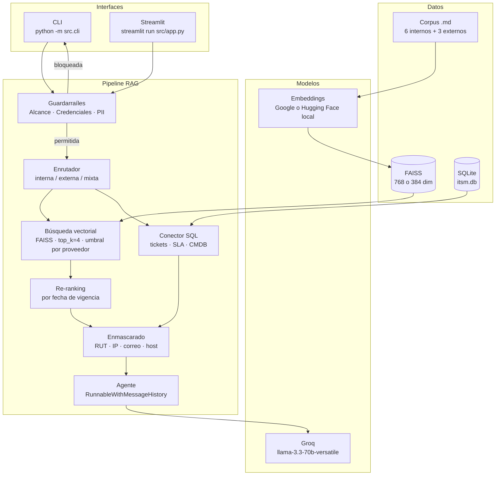

# Asistente RAG para Mesa de Ayuda TI — Aconcagua Logística SpA

> **EP1 · ISY0101 Ingeniería de Soluciones con IA — Duoc UC**

Asistente conversacional con **Retrieval-Augmented Generation (RAG)** que apoya a los agentes de Nivel 1 de la mesa de ayuda de TI de Aconcagua Logística SpA, una empresa chilena de transporte y distribución con 450 colaboradores, 5 sucursales y un centro de distribución.

El sistema recupera el procedimiento aplicable a cada consulta desde la base documental interna y externa, complementa con datos del ITSM vía SQL, y entrega al agente una respuesta con pasos numerados, diagnóstico probable, tiempo comprometido según el SLA, criterio de escalamiento y cita de la fuente.

## Agente EP2 — Etapa 4

La continuación EP2 incorpora una CLI independiente con LangChain Agents y
Groq `openai/gpt-oss-20b`. El modelo selecciona entre seis herramientas:
`consultar_ticket`, `consultar_sla`, `consultar_activo`, `buscar_procedimiento`,
`analizar_incidente` y `registrar_nota_ticket`. La última prepara una vista previa
y pausa: solo el campo humano `CONFIRMAR` autoriza una escritura en SQLite EP2.
El ITSM original se consulta en modo solo lectura.

Con `.venv` activado, el índice existente y la misma clave de Groq:

```powershell
python -m src.ep2.cli --usuario agente_demo --sesion sesion_demo --perfil agente
python -m pytest -q
python -m pip check
# Integración manual real; consume cuota de Groq.
python -m eval.check_ep2_agent --offline-embeddings
# Continuidad real con Groq entre dos procesos nuevos.
python -m eval.check_ep2_memory
# Plan adaptativo real: tres procesos CLI, con pausas entre fases por cuota.
python -m eval.check_ep2_plan
```

`EP2_LLM_MODEL` configura el modelo EP2; `LLM_MODEL` conserva el modelo EP1.
Los límites predeterminados son 8 iteraciones, 90 segundos por ciclo y 30 segundos
por petición al LLM; se configuran con las variables EP2 de `.env.example`.
No sobrescribir un `.env` existente. Las interfaces EP1 y los embeddings
Hugging Face/Google se conservan. Esta CLI local no autentica usuarios. Persiste
intercambios resumidos, hechos con procedencia y estado de tarea en SQLite EP2,
separados por usuario, sesión y perfil. Para continuar tras `/salir`, ejecutar
de nuevo con los mismos identificadores. Conserva seis intercambios y hasta 32
hechos por contexto, con retención de 30 días y límites configurables.
Las autorizaciones de escritura no se restauran. El agente incorpora un plan
validado con prioridades, dependencias y estados, actualizado por resultados
reales. La CLI muestra plan inicial, observaciones, cambios y resultado final.
Un nuevo reporte de impacto reabre verificaciones y separa prioridad registrada
de propuesta. `POSPONER` conserva una nota pendiente sin escribirla; al reabrir
se necesita una nueva vista previa y confirmación. Etapa 5 queda pendiente.
La Etapa 4 pasa 308 pruebas automáticas; su validación real completa está
pendiente por cuota diaria de Groq (última corrida real: **11/15 verificaciones**).
Los intentos parciales están documentados
en la evidencia, sin presentarlos como una demostración integral aprobada.

Ver [planificación y ejecución EP2 actual](docs/ep2_etapa4.md),
[evidencia del plan adaptativo](docs/evidencias/ep2_plan_real.md),
[memoria persistente](docs/ep2_etapa3.md),
[arquitectura de herramientas](docs/ep2_etapa2.md),
[controles transaccionales de Etapa 1](docs/ep2_etapa1.md) y
[evidencia de continuidad real](docs/evidencias/ep2_memoria_real.md).

---

## Arquitectura



---

## Requisitos previos

- **Python 3.11 o superior** instalado y en el PATH.
- **API key de Groq**; la de Google solo se requiere al usar embeddings de Google.
- Conexión a Internet para Groq, Google si se selecciona, y la primera descarga del modelo local.

---

## Cómo obtener las API keys

| Proveedor | Modelo | Variable | Cómo obtenerla |
|---|---|---|---|
| **Groq** | `llama-3.3-70b-versatile` | `LLM_API_KEY` | Crear cuenta en [console.groq.com](https://console.groq.com/keys) → API Keys → Create. Cuota gratuita: 100.000 tokens/día. |
| **Google AI Studio** | `gemini-embedding-001` | `GOOGLE_API_KEY` | Ir a [aistudio.google.com/app/apikey](https://aistudio.google.com/app/apikey) → Crear clave. Cuota gratuita: 1.000 peticiones de embeddings/día. |

---

## Instalación paso a paso

```bash
# 1. Clonar el repositorio
git clone <URL_DEL_REPOSITORIO>
cd mesa-ayuda-ti-rag

# 2. Crear y activar el entorno virtual
python -m venv .venv
# Linux / macOS:
source .venv/bin/activate
# Windows:
.venv\Scripts\activate

# 3. Instalar las dependencias
pip install -r requirements.txt

# 4. Configurar las credenciales
cp .env.example .env
# Editar .env con la clave de Groq; Google es opcional con embeddings locales
```

---

## Comandos de ejecución (en orden)

```bash
# 1. Crear y poblar la base de datos del ITSM y la CMDB
python data/seed_db.py

# 2. Construir el índice vectorial FAISS
python -m src.ingest

# 3. Iniciar la interfaz de consola (modo conversación)
python -m src.cli

# 4. Iniciar la interfaz web de Streamlit
streamlit run src/app.py

# 5. Ejecutar la evaluación con LLM juez
python -m eval.evaluate

# 6. Correr las pruebas unitarias (sin API keys)
pytest
```

---

## Variables de entorno

| Variable | Obligatoria | Descripción | Valor por defecto |
|---|---|---|---|
| `LLM_API_KEY` | Sí | Clave de API de Groq | — |
| `LLM_BASE_URL` | Sí | Endpoint compatible con OpenAI | `https://api.groq.com/openai/v1` |
| `LLM_MODEL` | No | Modelo de chat | `llama-3.3-70b-versatile` |
| `GOOGLE_API_KEY` | Solo con Google | Clave de Google AI Studio | — |
| `EMBEDDING_PROVIDER` | No | `google` o `huggingface` | `google` (`.env.example` selecciona `huggingface`) |
| `EMBEDDING_MODEL` | No | Modelo de embeddings | Google: `models/gemini-embedding-001`; local: `sentence-transformers/all-MiniLM-L6-v2` |
| `EMBEDDING_DIM` | No | Dimensiones del vector | Google: `768`; local: `384` |
| `HF_SIMILARITY_THRESHOLD` | No | Umbral de recuperación local entre 0 y 1; Google conserva `0.72` | `0.471764` |
| `LANGCHAIN_TRACING_V2` | No | Activa LangSmith | `false` |
| `LANGCHAIN_API_KEY` | No | Clave de LangSmith | — |
| `LANGCHAIN_PROJECT` | No | Proyecto en LangSmith | `mesa-ayuda-ti-rag` |
| `LANGCHAIN_ENDPOINT` | No | Endpoint de LangSmith | `https://api.smith.langchain.com` |

Para usar embeddings locales, definí `EMBEDDING_PROVIDER=huggingface`,
`EMBEDDING_MODEL=sentence-transformers/all-MiniLM-L6-v2` y `EMBEDDING_DIM=384`.
El modelo se ejecuta en CPU, con vectores normalizados y sin clave de Google.
Para volver a la alternativa original, usá `google`, `models/gemini-embedding-001`
y `768`, con una `GOOGLE_API_KEY` válida. La configuración de Groq no cambia.

Después de cambiar proveedor, modelo o dimensión, ejecutá `python -m src.ingest`.
La caché distingue cada configuración y FAISS rechaza índices incompatibles o
antiguos sin metadatos. La reconstrucción guarda primero el índice nuevo y
conserva el anterior en `storage/faiss_index-respaldo-*`; no elimina el corpus,
la caché ni la base ITSM. `storage/`, `.cache/` y `.env` están excluidos de Git.

El umbral original de Google (`0.72`) se conserva. Para Hugging Face se usa
`HF_SIMILARITY_THRESHOLD=0.471764`, calibrado para `all-MiniLM-L6-v2` con el
dataset existente. Cambiar el umbral no requiere reconstruir el índice ni la caché.
Los scores de esta versión de LangChain son `1 - distancia_L2_cuadrada / sqrt(2)`;
no representan probabilidad ni coseno. La calibración conserva esa escala.

Para reproducir el barrido completo sin Groq ni LLM juez:

```bash
python -m eval.calibrate_retrieval --offline
```

El comando compara todos los intervalos definidos por los scores, exige rechazo
de los casos sin fuente, maximiza aciertos de fuente@4 y desempata por precisión
documental proxy. Escribe el informe y la curva en `.cache/calibracion-huggingface.md`
y `.json`. La precisión documental mide coincidencia de archivo, no relevancia
de cada fragmento. Los resultados y límites están en
[la evidencia de calibración](docs/evidencias/calibracion_embeddings_locales.md).
Si se cambia el modelo o el corpus, hay que repetir esta evaluación.

---

## Tabla de resultados de evaluación

La evaluación se ejecutó sobre un conjunto de 10 casos de prueba representativos.

| Métrica | Resultado | Meta |
|---|---:|---:|
| Fidelidad | 0.880 | ≥ 0.85 |
| Relevancia de la respuesta | 0.940 | ≥ 0.80 |
| Precisión del contexto | 0.990 | ≥ 0.75 |
| Acierto de fuente | 100% (10/10) | ≥ 80% |

Los resultados se almacenan en `eval/resultados/` como `.json` (detalle por pregunta) y `.md` (tabla resumen).

---

## Estructura de carpetas

```
mesa-ayuda-ti-rag/
├─ README.md                        # Este archivo
├─ requirements.txt                 # Dependencias del proyecto
├─ .env.example                     # Plantilla de variables de entorno
├─ .gitignore                       # Archivos excluidos del repositorio
├─ conftest.py                      # Configuración de pytest
├─ src/
│  ├─ __init__.py
│  ├─ config.py                     # Carga de env, constantes, fábricas, caché, backoff
│  ├─ ingest.py                     # Pipeline de ingesta → índice FAISS
│  ├─ retriever.py                  # Retriever vectorial + SQL + enrutador + re-ranking
│  ├─ prompts.py                    # P1, P2, P3 como constantes versionadas
│  ├─ guardrails.py                 # Enmascarado PII/IP/host + perfiles + política
│  ├─ memory.py                     # Ventana de 6 turnos + resumen de sesión
│  ├─ agent.py                      # Cadena principal (RunnableWithMessageHistory)
│  ├─ cli.py                        # Interfaz de consola
│  └─ app.py                        # Interfaz Streamlit
├─ data/
│  ├─ internos/                     # 6 documentos .md del corpus interno
│  ├─ externos/                     # 3 documentos .md de proveedores y CSIRT
│  ├─ seed_db.py                    # Crea y puebla itsm.db
│  └─ evaluacion/
│     └─ dataset.json               # 20 preguntas con respuesta de referencia
├─ eval/
│  ├─ __init__.py
│  ├─ evaluate.py                   # LLM-as-judge: fidelidad, relevancia, precisión
│  └─ resultados/                   # Salida .json y .md de cada corrida
├─ docs/
│  ├─ arquitectura.md               # Descripción de capas + diagrama Mermaid
│  ├─ pipeline.md                   # Decisiones de chunking, embeddings, top_k, umbral
│  ├─ prompts.md                    # Los 3 prompts y su justificación
│  ├─ bocetos/                      # Bocetos de la interfaz + README explicativo
│  │  └─ README.md
│  └─ evidencias/                   # Capturas y logs de las pruebas ejecutadas
│     └─ README.md
└─ tests/
   ├─ test_chunking.py              # Fragmentación y separadores
   ├─ test_retriever.py             # Umbral, filtros y re-ranking
   ├─ test_guardrails.py            # Enmascarado, credenciales y alcance
   └─ test_prompts.py               # Estructura y variables de los prompts
```

---

## Limitaciones conocidas

1. **Cuota diaria limitada.** Groq ofrece 100.000 tokens/día y Gemini 1.000 peticiones de embeddings. Una evaluación completa de 20 preguntas puede consumir una porción significativa de la cuota. Se implementa backoff exponencial ante HTTP 429 y caché de embeddings en disco.
2. **Datos ficticios.** Los RUT, correos, IP y tickets son simulados. Los RUT usan números del tramo 30.000.000+ (no asignado en Chile) con dígito verificador válido.
3. **Sin conexión a plataformas reales.** La base de datos SQLite reemplaza al ITSM y la CMDB; no se conecta a ServiceNow, Jira ni ningún sistema productivo.
4. **Modelo no ejecuta acciones.** El asistente no cierra tickets, no resetea contraseñas ni modifica el directorio. Solo consulta y responde.
5. **Enrutador por heurística de palabras clave.** La clasificación interna/externa/mixta es deliberadamente simple. Una clasificación equivocada solo cambia el filtro de fuente; `mixta` nunca deja fuera documentos.
6. **Idioma fijo.** El corpus, los prompts y las interfaces están en español de Chile. No se soporta multiidioma.
7. **Memoria en proceso.** El historial de sesión vive en memoria y no se persiste. Al reiniciar la aplicación se pierde la conversación.
8. **LangSmith opcional.** La trazabilidad con LangSmith está disponible pero no es obligatoria. El sistema funciona igual sin ella.

---

## Licencia

Proyecto académico de evaluación. Uso exclusivo para la asignatura ISY0101 de Duoc UC.
