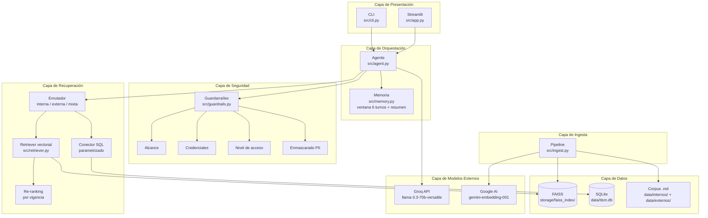
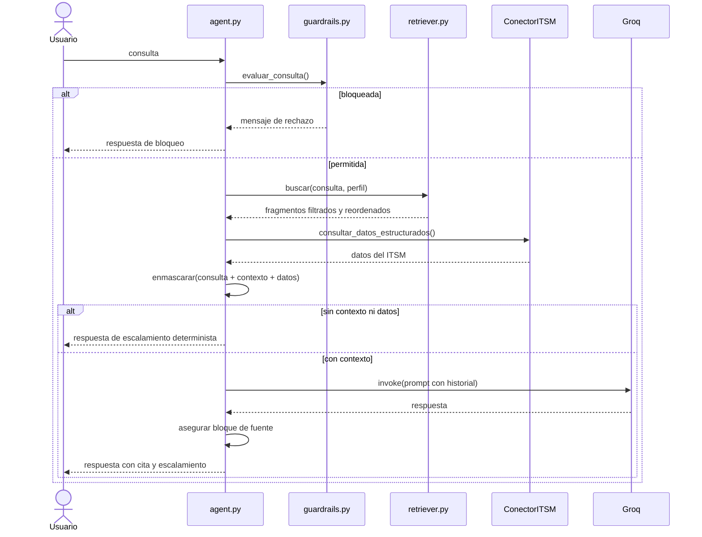

# Arquitectura del Asistente RAG — Mesa de Ayuda TI

## Visión general

El asistente es un sistema RAG (Retrieval-Augmented Generation) que combina recuperación vectorial sobre documentos no estructurados con consultas SQL sobre datos estructurados del ITSM. Está diseñado para operar como herramienta de apoyo al agente humano de Nivel 1, nunca como reemplazo: no ejecuta acciones, no entrega credenciales y siempre cita la fuente de sus indicaciones.

## Diagrama de capas

## Descripción de capas

### Capa de Presentación

Dos interfaces que consumen la misma API del agente:

- **CLI** (`src/cli.py`): modo conversación con selector de perfil, comandos `/fuentes`, `/reiniciar`, `/perfil`. Útil para la evaluación rápida y para operar sin navegador.
- **Streamlit** (`src/app.py`): historial visual, panel lateral con parámetros del pipeline, y un expander por respuesta que muestra los fragmentos recuperados con su puntaje y fecha de vigencia.

### Capa de Orquestación

- **Agente** (`src/agent.py`): cadena `prompt | llm | parser` envuelta en `RunnableWithMessageHistory`. Orquesta los 7 pasos del pipeline: guardarraíles → enrutamiento → recuperación → SQL → enmascarado → modelo → verificación de salida.
- **Memoria** (`src/memory.py`): ventana deslizante de los últimos 6 intercambios más resumen de sesión. Lo que sale de la ventana se pliega con un resumidor (LLM o heurístico), para que el contexto del síntoma sobreviva a la conversación.

### Capa de Seguridad

Cuatro controles aplicados en orden:

1. **Alcance**: rechaza consultas fuera del ámbito de TI (recetas, fútbol, criptomonedas).
2. **Credenciales**: bloquea toda solicitud del valor de una contraseña, PIN, token o código de verificación. No confunde con consultas legítimas sobre el procedimiento de restablecimiento.
3. **Nivel de acceso**: el perfil `usuario_final` solo ve documentos marcados `publico_interno`; el perfil `agente` ve todo.
4. **Enmascarado**: RUT, correos, teléfonos, IP y hostnames se reemplazan por marcas **antes** de la llamada al modelo, no después.

### Capa de Recuperación

- **Enrutador**: clasifica la consulta en `interna`, `externa` o `mixta` por heurística de palabras clave, y filtra el índice por el metadato `fuente`.
- **Retriever vectorial**: `similarity_search_with_relevance_scores` con `top_k=4` y umbral 0,72. Se piden `top_k * 5` candidatos para compensar el filtrado posterior.
- **Re-ranking por vigencia**: entre fragmentos con puntaje equivalente (diferencia < 0,05), prevalece el documento con `fecha_vigencia` más reciente. Esto permite que un aviso del CSIRT supere a un procedimiento interno desactualizado.
- **Conector SQL**: consultas parametrizadas con marcadores `?` a las tablas `tickets`, `sla`, `activos_cmdb` y `usuarios`. Detecta en la consulta identificadores de ticket, prioridades y RUT. Nunca interpola texto del usuario en el SQL.

### Capa de Datos

- **FAISS**: índice vectorial de 768 dimensiones, persistido en `storage/faiss_index/`. Solo contiene los documentos del corpus, nunca tickets ni datos de la CMDB.
- **SQLite** (`data/itsm.db`): 5 tablas que simulan el ITSM y la CMDB. 12 usuarios, 40 tickets, 20 activos, 6 categorías de servicio y 4 niveles de SLA.
- **Corpus**: 6 documentos internos (KB, catálogo de servicios, política de seguridad) y 3 externos (Microsoft, Fortinet, CSIRT). Cada uno con frontmatter YAML.

### Capa de Modelos Externos

- **Groq** (`llama-3.3-70b-versatile`): modelo de chat a temperatura 0,1 con máximo 700 tokens. Se accede vía endpoint compatible con OpenAI. Cuota gratuita: 100.000 tokens/día.
- **Google AI** (`gemini-embedding-001`): embeddings de 768 dimensiones con caché en disco (SQLite). La caché evita recalcular vectores al reingestar. Cuota gratuita: 1.000 peticiones/día.

### Capa de Ingesta

- **Pipeline** (`src/ingest.py`): carga → normalización → fragmentación (`RecursiveCharacterTextSplitter`, 900 caracteres, 150 de solape) → metadatos → embeddings → FAISS. Idempotente por manifiesto con hash del corpus y los parámetros.

## Flujo de una consulta

## Decisiones de diseño relevantes

1. **Tickets no vectorizados.** Son datos estructurados con identificadores exactos: buscarlos por similitud semántica sería más lento y menos preciso que SQL.
2. **Enmascarado antes de la llamada.** Se enmascara la entrada, no la salida. Enmascarar la respuesta deja los datos igualmente enviados al proveedor.
3. **Respuesta determinista sin contexto.** Si no hay fragmentos ni datos del ITSM, la respuesta es literal y no se gasta una llamada al modelo.
4. **Caché de embeddings.** Un SQLite local guarda los vectores ya calculados, keyed por SHA-256 del modelo, el tipo y el texto. Cambiar de modelo invalida la caché automáticamente.
5. **Backoff exponencial.** Los reintentos ante HTTP 429 siguen `espera_base^n + jitter`, con un techo de 60 segundos. Solo se reintenta error de cuota; cualquier otro error se propaga de inmediato.
