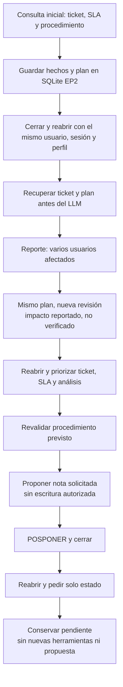
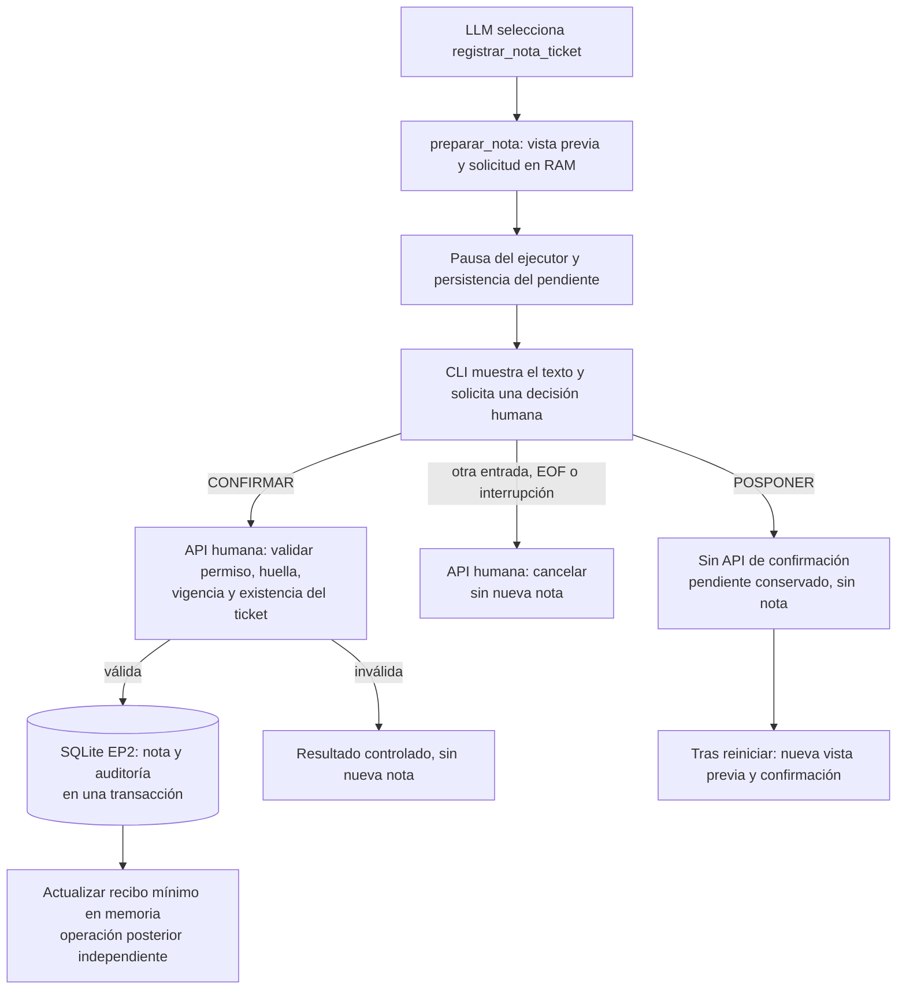

# Bocetos documentales de los flujos EP2

Estos esquemas describen la interfaz implementada; no son capturas, transcripciones
ni resultados de una ejecución nueva. Los identificadores entre `<...>` son
marcadores ilustrativos, no datos de una corrida. La [evidencia real del cierre](../evidencias/ep2_etapa4_cierre_tecnico.md)
permanece separada. No se propone una interfaz web EP2.

## 1. Consulta y observaciones

```text
EP2 · Modelo openai/gpt-oss-20b · Perfil agente
Sesión de simulación local, sin autenticación empresarial. /salir termina.
Memoria persistente · Usuario <usuario> · Sesión <sesion>

Consulta: Consulta el ticket INC-2026-0411 y su SLA. Busca el procedimiento
          documentado de VPN/FortiClient. No propongas notas todavía.

Plan inicial · <uuid> · revisión <revision>
  consultar_ticket       pendiente
  consultar_sla          pendiente · depende de ticket
  buscar_procedimiento   pendiente · depende de ticket y SLA

Observación [herramienta · <fecha UTC>] consultar_ticket: TICKET_CONSULTADO.
Procedencia: itsm:ticket:INC-2026-0411
Plan actualizado · <mismo uuid> · revisión <revision posterior>
  ... estados y dependencias actualizados por resultados ...

<respuesta basada en resultados y fuentes>
Fuentes verificadas: <procedencias obtenidas>
Herramientas: <nombres y códigos de las herramientas ejecutadas>
```

La disposición está simplificada. `mostrar_trazabilidad()` imprime antes del LLM
el plan y, después de cada herramienta, la observación y el plan actualizado.
El orden elegible depende del plan; una selección rechazada no acredita ejecución.
La respuesta distingue fuentes del turno de observaciones históricas de memoria.

Código: [CLI](../../src/ep2/cli.py),
[AgenteEP2](../../src/ep2/agente.py) y
[proyección por decisión](../../src/ep2/contexto.py).

## 2. Replanificación y continuidad



```text
Consulta: Ahora hay varios usuarios afectados. Reevalúa el impacto reportado
          del mismo ticket y propón una nota de seguimiento.

Plan inicial · <mismo uuid> · revisión <revision posterior>
  ticket / SLA / análisis    verificaciones priorizadas
  procedimiento             revalidación prevista
  propuesta de nota         espera verificaciones previas

Impacto: multiples_usuarios · reporte no verificado
Prioridad registrada: <lectura ITSM>; propuesta: <según evidencia SLA>
```

El reporte del usuario no cambia la prioridad del ITSM ni prueba una causa raíz.
La prioridad de los pasos del plan es distinta de P1–P4. El código controla sus
transiciones y mantiene el impacto como no verificado.

Código: [Planificador](../../src/ep2/planificacion.py) y
[MemoriaEP2](../../src/ep2/memoria.py). Evidencia: [integral 15/15](../evidencias/ep2_etapa4_cierre_tecnico.md).
Regresiones: [replanificación](../../tests/test_ep2_planificacion.py) y
[continuidad del contexto](../../tests/test_ep2_contexto.py).

## 3. Confirmación humana independiente del LLM

```text
<mensaje de solicitud de confirmación>
<texto exacto enmascarado de la vista previa>
La nota todavía no se ha registrado.

Escribe CONFIRMAR para registrar, POSPONER para revisar luego;
otra respuesta cancela: <entrada humana>
```



`confirmar_nota()` no forma parte del registro de herramientas del LLM. Un
«confirmo» en el chat no sustituye al campo humano. La memoria del pendiente
no conserva tokens, huellas de autorización ni el cuerpo de la propuesta.
Si falla la actualización posterior de memoria, no se afirma haber revertido
una nota ya confirmada. Una cancelación tampoco revierte una nota ya registrada.

Código: [resolver_confirmaciones()](../../src/ep2/cli.py),
[preparación y confirmación](../../src/ep2/herramientas.py) y
[transacción de escritura](../../src/ep2/almacenamiento.py).
Las ramas de confirmación efectiva tienen [pruebas automatizadas](../../tests/test_ep2_etapa1.py)
con SQLite temporal; la integral real de cierre utilizó `POSPONER`.

## Guion de demo sin escrituras de negocio

Requiere datos ficticios existentes, índice compatible, modelo local descargado
y autorización/cuota para Groq. No ejecutar `seed_db.py` ni reingestar para
consultar este caso. La siguiente invocación abre una sesión local:

```powershell
python -m src.ep2.cli --usuario agente_demo_ep2 --sesion defensa_ep2_01 --perfil agente
```

1. Usar la solicitud inicial de [PREGUNTAS](../../eval/check_ep2_plan.py):
   «Consulta el ticket INC-2026-0411 y su SLA. Busca el procedimiento documentado
   para conectar la VPN corporativa con FortiClient y verificar el acceso a los
   recursos internos. No propongas notas todavía.»
2. Escribir `/salir` y reabrir con el mismo comando para mostrar recuperación.
3. Pedir: «Ahora hay varios usuarios afectados. Reevalúa el impacto reportado
   del mismo ticket, distingue prioridad registrada y propuesta y propón una nota
   de seguimiento. No he confirmado ninguna escritura.»
4. En el campo independiente de confirmación, introducir `POSPONER`; luego `/salir`.
5. Reabrir con el mismo comando y pedir: «Retoma el plan pendiente de esta sesión
   y muestra su estado desde la memoria, sin ejecutar acciones ni preparar nuevas
   notas. Explica qué falta para confirmar humanamente.»

Observar el UUID del mismo plan, sus revisiones, dependencias y pendientes.
La memoria y el plan se actualizan, pero no se autoriza una nota. Usar una sesión
nueva para cada ensayo; la reanudación dentro del ensayo utiliza los mismos
identificadores. Este guion manual no realiza por sí solo un recuento de filas.

El [evaluador integral existente](../../eval/check_ep2_plan.py) automatiza las
tres fases con SQLite EP2 temporal, `POSPONER` guionado, recuentos de cero notas
y auditorías y comparación del hash del ITSM. Su comando es
`python -m eval.check_ep2_plan`: llama a Groq y genera reportes locales; no debe
ejecutarse como parte de una revisión documental. Sus controles de cuota y
tiempo son distintos de los de la [CLI normal](../../README.md#instalación-y-ejecución-ep2).

La pauta exige demo en vivo, dentro de diez minutos de exposición más diez de
preguntas y con participación de ambos integrantes. La grabación es un respaldo,
no sustituye la demo. La integral documentada sumó aproximadamente siete minutos
con sus pausas; el ensayo debe contemplar tiempos y disponibilidad del proveedor,
sin atribuir al guion nuevas ejecuciones o resultados garantizados.
