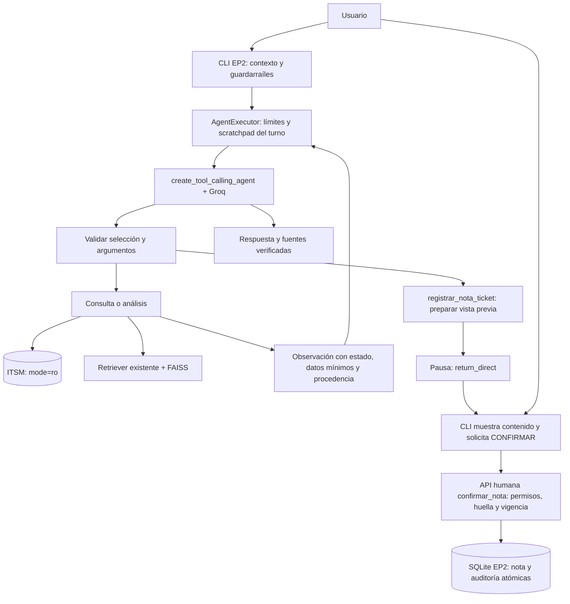

# EP2 — Etapa 2: agente funcional y herramientas

Implementación verificada el 15 de octubre de 2026. Continúa la
[Etapa 1](ep2_etapa1.md), con LangChain Agents y el modelo Groq autorizado
`openai/gpt-oss-20b`. Se conserva el asistente EP1 y su `LLM_MODEL` independiente.
No se implementa todavía memoria conversacional persistente ni planificación
avanzada: corresponden a las etapas 3 y 4.

## Ejecución

Archivos creados en esta etapa: `src/ep2/agente.py`, `src/ep2/configuracion.py`,
`src/ep2/cli.py`, `eval/check_ep2_agent.py`, `tests/test_ep2_agente.py`, este
documento y `docs/evidencias/ep2_integracion_real.md`. Archivos modificados:
`src/ep2/contratos.py`, `src/ep2/herramientas.py`, `src/ep2/__init__.py`,
`.env.example`, `README.md` y `.env` local (solo `EP2_LLM_MODEL`).

Desde la raíz, con el entorno virtual activado, las credenciales existentes y
el índice FAISS ya construido:

```powershell
python -m src.ep2.cli --usuario agente_demo --sesion sesion_demo --perfil agente
```

`/salir` termina. Los identificadores son opacos y el perfil lo fija la aplicación,
nunca el mensaje ni el modelo. Esta CLI es una demostración local sin autenticación
empresarial; no debe exponerse como servicio multiusuario sin validar identidades.
Para comprobar restricciones, iniciar con `--perfil usuario_final`.
Las interfaces originales siguen siendo `python -m src.cli` y
`streamlit run src/app.py`.

No copiar `.env.example` sobre un `.env` existente. Las nuevas variables son:

| Variable | Predeterminado | Uso |
|---|---|---|
| `EP2_LLM_MODEL` | `openai/gpt-oss-20b` | Modelo de EP2, independiente de `LLM_MODEL`. |
| `EP2_MAX_ITERATIONS` | `8` | Máximo de iteraciones del ejecutor; incluye correcciones de decisiones inválidas. |
| `EP2_MAX_SECONDS` | `90` | Límite cooperativo del ciclo en segundos. |
| `EP2_LLM_TIMEOUT` | `30` | Timeout por petición al LLM, acotado también por `EP2_MAX_SECONDS`. |

Se reutilizan `LLM_API_KEY`, `LLM_BASE_URL`, temperatura y máximo de tokens
existentes. La fábrica EP1 no cambia. EP2 desactiva los reintentos automáticos del
cliente LLM para mantener acotadas las llamadas; un HTTP 429/404 se informa con su
código, sin incluir el cuerpo de la excepción. No se instalaron ni actualizaron
dependencias en esta etapa: se comprobó LangChain 0.3.30, Core 0.3.86 y el conector
`langchain-openai` 0.3.35 mediante llamadas reales a Groq.

## Orquestación y frontera de escritura



El registro usa `StructuredTool` con contratos Pydantic que rechazan campos extra.
`create_tool_calling_agent` convierte la selección del modelo en acciones;
`AgentExecutor` ejecuta la herramienta y entrega su observación al modelo para la
siguiente decisión. No existe un enrutador fijo de herramientas por palabras clave.
Los guardarraíles de alcance existentes se ejecutan antes de este ciclo.

Se acepta una herramienta por iteración. Un lote de varias o un nombre desconocido
se rechaza antes de ejecutar ninguna acción y consume una iteración de corrección.
Esto también asegura la pausa de `return_direct`: en la versión instalada, el
ejecutor solo termina directamente cuando el paso contiene una única acción.

| Herramienta del agente | Resultado y procedencia | Permisos |
|---|---|---|
| `consultar_ticket` | Campos técnicos del ITSM y notas EP2 confirmadas del mismo usuario/sesión. | Agente. |
| `consultar_sla` | Tiempos y tipo de reloj registrados para P1–P4. | Ambos perfiles. |
| `consultar_activo` | Activo asociado al ticket; omite titular, RUT, IP y hostname. | Agente. |
| `buscar_procedimiento` | Fragmentos FAISS, puntajes y archivos; aplica filtros y umbral existentes. | Según visibilidad documental del perfil. |
| `analizar_incidente` | Triage versionado sobre estado, nivel y SLA: resuelto, seguimiento Nivel 2 o consultar procedimiento. | Agente. |
| `registrar_nota_ticket` | Vista previa enmascarada y solicitud pendiente; ninguna escritura. | Agente; confirmación humana posterior obligatoria. |

El triage no comprueba infraestructura, no confirma una causa raíz, no cambia la
prioridad ni calcula vencimientos sin un calendario. Su resultado declara
`diagnostico_confirmado=false`. La selección posterior corresponde al agente,
dentro del ciclo acotado; aún no existe un plan persistente de tareas.

El LLM solo recibe `ticket_id` y `texto` como argumentos de propuesta. La aplicación
genera el UUID de operación y fija el contexto. `confirmar_nota` **no** aparece
en el registro de herramientas. La propuesta detiene el ciclo antes de devolver
su solicitud al modelo. La CLI muestra el texto exacto que se guardaría; solo
escribir `CONFIRMAR` en ese campo independiente autoriza el registro. Otra entrada,
EOF o interrupción cancelan. Decir «sí, confirmo» en el chat no autoriza cambios.

La API humana conserva los controles de Etapa 1: vínculo con usuario y sesión,
huella del contenido, permiso, ticket vigente, caducidad de cinco minutos,
transacción nota + auditoría e idempotencia. Solo escribe `storage/ep2/agent.db`.
Las confirmaciones pendientes caducan al reiniciar; una propuesta nueva necesita
otra confirmación. No se cambia el esquema ni se escribe en `data/itsm.db`.

## Errores, trazas y recuperación

`RespuestaAgenteEP2` distingue respuesta, denegación, falta de contexto, límite,
error y confirmación pendiente. Incluye nombres de herramientas, códigos,
estados, duración y procedencia. Las trazas básicas quedan en la respuesta y
se muestran en la CLI; no persisten conversaciones ni razonamiento interno.
`escrituras_realizadas=0` describe exclusivamente el ciclo del modelo; el recibo
de la API humana acredita una eventual escritura posterior.

Los errores de herramienta se convierten en observaciones controladas, sin
excepciones ni credenciales. El modelo puede decidir otra consulta permitida
usando la observación. Al agotar iteraciones/tiempo, la respuesta señala que la
tarea está incompleta. El tiempo es cooperativo: no interrumpe a mitad una
operación síncrona FAISS/SQLite ni ajusta cada petición al presupuesto restante.
Una llamada en curso puede superar el límite global; el timeout del LLM limita
la espera de red. La primera carga local de embeddings también puede ser lenta.

La búsqueda reutiliza el retriever, caché e índice existentes con Hugging Face
`all-MiniLM-L6-v2`, 384 dimensiones y umbral `0.471764`; Google conserva su
alternativa y umbral `0.72`. No se reconstruyó el índice ni se repitió la
calibración. Si la búsqueda no recupera contexto admisible, la aplicación devuelve
el mensaje original de falta de procedimiento aunque el modelo proponga pasos.
Los documentos se tratan como datos y se enmascaran antes de enviarlos al LLM.

## Verificación y evidencia

```powershell
python -m pytest -q
python -m pip check
# Manual: llama realmente a Groq y consume cuota; embeddings ya descargados.
python -m eval.check_ep2_agent --offline-embeddings
# Opcional: repetir un caso individual.
python -m eval.check_ep2_agent --offline-embeddings --caso nota
```

Suite completa: **214 aprobadas** (181 anteriores + 33 nuevas).
`pip check`: **No broken requirements found**. Las pruebas automáticas usan un
modelo guionado sobre el ciclo real de LangChain y SQLite temporal; no prueban la
conectividad con Groq. Cubren observaciones, herramientas, permisos, argumentos
suplantados, lotes inválidos, confirmación exclusivamente humana, límites,
errores, aislamiento del scratchpad y filtros RAG.

La integración manual sí llamó a Groq y ejercitó las seis herramientas con el
ITSM y FAISS locales reales. Los cuatro casos pasaron en la repetición completa,
incluida la pausa de nota con cero escrituras. El verificador usa una base EP2
temporal, comprueba el hash del ITSM y conserva los intentos en
`.cache/ep2_integracion_real.json`, excluido de Git. Véase la
[evidencia y los incidentes de verificación](evidencias/ep2_integracion_real.md).

## Correspondencia con la pauta y límites pendientes

| Indicador | Evidencia de esta etapa |
|---|---|
| IE1 | Seis herramientas registradas; selección autónoma y ejecución real con observaciones. Propuesta de escritura separada del evento humano autorizado. Pruebas de permisos y prevención de escritura. |
| IE2 | LangChain Agents con las versiones instaladas, contratos tipados y servicios separados. Compatibilidad real con Groq 20b; fábricas y CLI EP1 independientes; sin cambio de dependencias. La separación permite ampliar herramientas, pero no se midió escalabilidad bajo carga. |
| IE4, aporte parcial | FAISS conectado como herramienta y recuperación real de VPN; continuidad entre sesiones pendiente. |
| IE6–IE8, aporte parcial | Flujo documentado, README ejecutable, casos reproducibles y resultados reales. Informe, entrega GitHub y demo final pendientes. |

La evaluación de cuatro casos valida integración y controles, no una tasa global
de fidelidad o relevancia. El texto generativo puede contener interpretaciones
imprecisas aunque cite fuentes existentes; el listado de fuentes prueba su
procedencia, no cada afirmación. La recuperación mantiene los límites ya medidos
en la [calibración](evidencias/calibracion_embeddings_locales.md): 11/19 aciertos
de archivo con fuente y 10/19 excluyendo cada pregunta de su calibración.

Quedan pendientes autenticación empresarial, evaluación semántica más amplia,
memoria de corto/largo plazo (IE3), planificación adaptativa verificable (IE5)
y presentación final. Los detectores de datos personales/secretos son heurísticos;
se deben usar datos ficticios en la demo. No se ejecutaron escrituras reales con
Groq: su propuesta quedó pendiente; la confirmación transaccional se prueba en
bases temporales automatizadas. La comprobación de Google sigue siendo por
pruebas sin API, no una llamada real nueva.

## Referencias técnicas

Groq. (s. f.). *GPT-OSS 20B*. GroqDocs.
https://console.groq.com/docs/model/openai/gpt-oss-20b

Groq. (s. f.). *Local tool calling*. GroqDocs.
https://console.groq.com/docs/tool-use/local-tool-calling

LangChain. (s. f.). *create_tool_calling_agent* [Código fuente instalado,
versión 0.3.30]. `langchain/agents/tool_calling_agent/base.py`.

Documento operativo preparado con ayuda de IA. No sustituye las conclusiones,
justificaciones técnicas ni reflexiones académicas que la pauta exige redactar
a los estudiantes sin IA. El trabajo se detiene al finalizar la Etapa 2.
