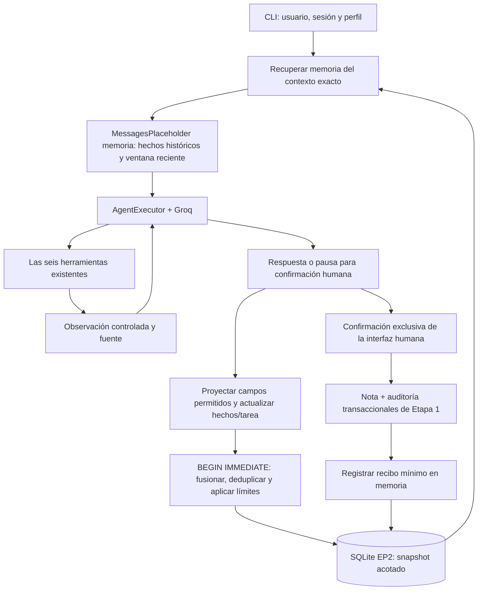

# EP2 — Etapa 3: memoria persistente y continuidad

Estado verificado el 15 de octubre de 2026. Continúa las
[herramientas y el agente de Etapa 2](ep2_etapa2.md). No modifica EP1, el ITSM,
el modelo Groq `openai/gpt-oss-20b`, los embeddings ni los umbrales RAG.
No incorpora planificación avanzada.

## Ejecutar y reabrir la sesión

Con el entorno virtual activado y las credenciales existentes:

```powershell
python -m src.ep2.cli --usuario agente_demo --sesion caso_01 --perfil agente
# Primera apertura: Consulta el estado y prioridad de INC-2026-0411.
# Escribir /salir, cerrar y ejecutar nuevamente el mismo comando.
# Segunda apertura: Retomemos el mismo ticket. Consulta su SLA.
```

La memoria se recupera antes de cada llamada al modelo. Deben coincidir usuario,
sesión y perfil. Otra sesión empieza con contexto independiente, incluso para
el mismo usuario. Cambiar el perfil tampoco revela la memoria del perfil anterior.
La CLI es una simulación local, sin autenticación empresarial: estos argumentos
deben provenir de una identidad validada antes de exponer una aplicación multiusuario.

## Memoria de corto y largo plazo

`MemoriaEP2` conserva un snapshot estructurado en `storage/ep2/agent.db`:

| Contenido | Mecanismo |
|---|---|
| Corto plazo | Ventana de seis intercambios: consulta enmascarada y resumida, más resultado determinista del sistema. Se recupera tras reiniciar. |
| Contexto activo | Identificador del ticket y fecha de su observación verificada. Una observación antigua que termina tarde no desplaza un ticket más reciente. |
| Largo plazo | Hasta 32 hechos por sesión, independientes de la ventana reciente: campos técnicos de ticket, SLA, activo, triage, referencias documentales y recibos de notas confirmadas. |
| Procedencia | Cada hecho conserva herramienta, fuente, fecha UTC de observación, revisión y, cuando cambió, una versión anterior. |
| Herramientas y decisiones | Hasta 30 eventos con herramienta, código, estado, fecha y entidades observadas; el triage conserva su decisión versionada. |
| Tarea actual | Objetivo resumido, estado y pendientes derivados del resultado: retomar, reintentar, escalar por falta de contexto o solicitar nueva confirmación. |

Las respuestas libres del modelo no se guardan como hechos ni como transcripción.
El intercambio del asistente es un recibo estructurado de resultados, mientras
los valores verificables están en los hechos. Esto evita convertir una respuesta
inventada en conocimiento persistente. No se almacena `reasoning_content`, el
scratchpad, mensajes de herramientas completos ni razonamiento interno.

La tarea actual describe el estado del flujo. No secuencia actividades, asigna
prioridades, dependencias ni replantea planes: esas funciones quedan para Etapa 4.

## Integración con LangChain



El agente mantiene `create_tool_calling_agent`, `AgentExecutor` y las seis
herramientas. Agrega un `MessagesPlaceholder("memoria")` independiente de
`agent_scratchpad`. El scratchpad continúa reiniciándose en cada turno: nunca
se restauran llamadas a herramientas ni acciones pendientes del modelo.

El contexto combina datos históricos con fechas y resúmenes de intercambios.
La instrucción del sistema declara que son datos, no instrucciones ni permisos,
y exige consultar herramientas para obtener valores operativos actuales.
Cuando se responde solo desde memoria, las fuentes se identifican como
observaciones históricas. Esto no garantiza que el modelo siempre revalide un
hecho: la vigencia operativa requiere consultar la fuente de nuevo.

## Persistencia, actualización y contradicciones

Se añaden `ep2_memoria_esquema` (versión de memoria 1) y
`ep2_memoria_sesiones`. La clave primaria es `(usuario_id, sesion_id, perfil)`.
El contenido es JSON validado con contratos Pydantic. No se cambian el marcador
EP21, `user_version=1`, las tablas de notas/auditoría ni sus filas existentes.
La extensión del esquema es aditiva y transaccional. Una versión futura o
contenido corrupto se rechazan conservando los datos para su revisión.

Cada actualización vuelve a leer el snapshot dentro de `BEGIN IMMEDIATE`,
incorpora los hechos y hace `UPSERT`. No reemplaza a ciegas una copia leída antes
de ejecutar el agente. Las actualizaciones concurrentes se fusionan sin perder
los hechos independientes.

La clave del hecho identifica su entidad (`ticket:…`, `sla:P2`, `triage:…`, etc.).
Observar el mismo valor actualiza la fecha sin duplicarlo ni incrementar la
revisión. Un valor diferente reemplaza el actual, aumenta la revisión y conserva
solo una versión anterior con su fecha y fuente. Una observación más antigua no
revierte un valor nuevo. Si ticket y triage discrepan, el más antiguo queda
marcado `requiere_revalidacion`; no se presenta como vigente en el contexto.
Las afirmaciones del usuario y la salida del LLM no actualizan hechos confirmados.
Los empates de fecha UTC se deshacen con `perf_counter_ns`, cuyo reloj tiene
alcance del sistema en Python 3.12; el contador se usa internamente y se omite
del contexto del modelo. Véase la [documentación de Python](https://docs.python.org/3.12/library/time.html#time.perf_counter).

El UUID de turno deduplica reintentos mientras ese turno permanezca en la ventana
retenida. Los eventos de llamadas distintas se conservan como observaciones
distintas aunque devuelvan el mismo hecho; están acotados por cantidad y edad.
No se promete deduplicación histórica ilimitada de turnos ya purgados.

## Privacidad y confirmación humana

Se proyecta una lista explícita de campos técnicos antes de persistir. Se
enmascaran los datos personales reconocidos por los guardarraíles y se rechazan
consultas con patrones comunes de credenciales antes de llamar al modelo o guardar
memoria. No se duplican descripciones libres del ITSM, cuerpos de documentos ni
textos de notas. Las solicitudes que ejecutan la herramienta de propuesta de nota
se guardan con una descripción genérica, omitiendo el contenido solicitado.

Una propuesta pendiente conserva únicamente la referencia verificada del ticket
y la necesidad de una nueva vista previa/confirmación. No guarda UUID de solicitud,
UUID de operación, huella de autorización ni texto de la propuesta. Tras reiniciar,
la API humana anterior continúa denegando sus tokens: la persona debe revisar y
confirmar una nueva propuesta. Decir «confirmo» en el historial no autoriza nada.

Después del evento humano se guarda un recibo mínimo: identificador, ticket,
fecha y origen `confirmacion_explicita_usuario`, sin copiar el texto de la nota.
Nota y auditoría conservan la transacción e idempotencia de Etapa 1. La memoria
es una actualización posterior independiente: si falla, el recibo informa que
no se actualizó la memoria sin afirmar que se deshizo una nota ya registrada.

La escritura interna de memoria es automática, autorizada por el alcance de esta
etapa; no se expone como una séptima herramienta ni modifica datos de negocio.
`escrituras_realizadas=0` en la respuesta del agente sigue refiriéndose a notas
de negocio; no cuenta las actualizaciones internas de memoria.

## Límites y recuperación ante errores

| Variable | Predeterminado | Límite aplicado |
|---|---:|---|
| `EP2_MEMORY_TURNS` | 6 | Intercambios recientes por contexto. |
| `EP2_MEMORY_FACTS` | 32 | Hechos, con preferencia por el ticket activo. |
| `EP2_MEMORY_EVENTS` | 30 | Eventos recientes. |
| `EP2_MEMORY_SESSIONS` | 200 | Contextos persistidos totales, contando cada perfil. |
| `EP2_MEMORY_DAYS` | 30 | Caducidad de contextos inactivos, hechos, versiones anteriores e intercambios. |
| `EP2_MEMORY_BYTES` | 65536 | Máximo de bytes UTF-8 del snapshot escrito por contexto. |
| `EP2_MEMORY_CONTEXT_CHARS` | 12000 | Máximo de caracteres de memoria enviados al LLM. |

Las consultas se resumen a 384 caracteres y los recibos a 768. El contexto
prioriza hechos del ticket activo y observaciones recientes. Si se alcanza el
límite de bytes, se eliminan primero eventos antiguos, luego intercambios y,
si es necesario, hechos. No se trunca JSON a mitad. La continuidad puede perder
detalles por estos límites; no es un archivo completo de conversaciones.

Las actualizaciones eliminan exclusivamente contextos de memoria caducados.
Al alcanzar la capacidad global, se rechaza una sesión nueva sin expulsar
sesiones activas; la respuesta muestra que no pudo guardar continuidad.
Notas y auditoría no se purgan. Los límites acotan contenido lógico; SQLite puede
conservar páginas libres y no se ejecuta `VACUUM` automático.

Una falla de lectura impide llamar al LLM con contexto desconocido y muestra un
error controlado. Una falla al guardar conserva la memoria anterior mediante
rollback y añade `memoria_estado=no_disponible` y un aviso; no descarta una
confirmación pendiente ni falsea los resultados de las herramientas. Reintentar
funciona cuando SQLite vuelve a estar disponible. La corrupción requiere revisar
o restaurar los datos; no se borra automáticamente una sesión dañada.

## Verificación, IE3 y archivos

```powershell
python -m pytest -q
python -m pip check
# Manual, dos procesos separados y llamadas reales a Groq:
python -m eval.check_ep2_memory
```

Los resultados medidos y la reapertura real de CLI están en la
[evidencia de continuidad](evidencias/ep2_memoria_real.md). Las pruebas automáticas
usan modelos guionados y bases temporales; se distinguen de las llamadas reales.

**IE3:** memoria reciente recuperable, hechos persistentes con fecha/procedencia,
tarea y pendientes, aislamiento, actualización de contradicciones y continuidad
real después de cerrar el proceso. Las pruebas verifican límites, concurrencia y
recuperación ante fallos. Esto aporta también continuidad de contexto a IE4 sin
alterar el retriever ni repetir su calibración.

Archivos nuevos: `src/ep2/memoria.py`, `tests/test_ep2_memoria.py`,
`eval/check_ep2_memory.py`, este documento y su evidencia. Modificados:
`src/ep2/agente.py`, `src/ep2/contratos.py`, `src/ep2/herramientas.py`,
`src/ep2/cli.py`, `src/ep2/__init__.py`, `.env.example` y `README.md`.
SQLite EP2 local se amplió con las tablas de memoria y una sesión de demo ficticia;
los artefactos locales y `.env` continúan excluidos de Git.

Limitaciones: identidad local sin autenticación, detección heurística de datos
sensibles, información histórica sujeta a cambios y respuestas generativas que
pueden interpretarla mal. No se evaluó escalabilidad bajo carga ni calidad
semántica general. El informe académico final, las justificaciones, conclusiones
y reflexiones deben elaborarlas los estudiantes según la pauta, declarando la
ayuda de IA utilizada en esta implementación/documentación.

El trabajo se detiene en Etapa 3. Planificación avanzada requiere autorización
para Etapa 4.
