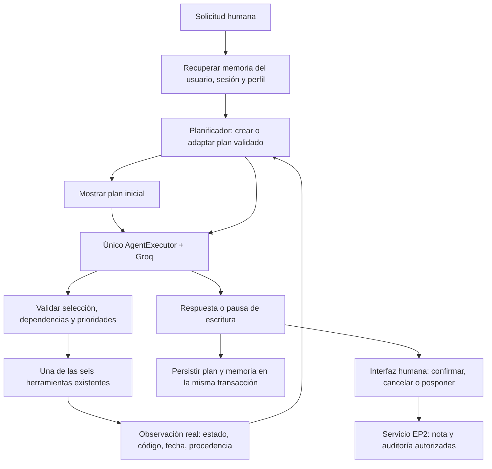

# EP2 — Etapa 4: planificación adaptativa y trazabilidad

Continuación de [Etapa 3](ep2_etapa3.md) sobre el commit estable
`8affe89f2b996dad326a8eba9dd531552c2dd431`. El estado inicial de Git estaba limpio,
en `master`, con 257 pruebas aprobadas. No se modifican EP1, el ITSM, FAISS,
embeddings, umbrales, dependencias ni credenciales.

## Arquitectura y ejecución

```powershell
python -m src.ep2.cli --usuario agente_demo --sesion caso_vpn --perfil agente
```

La CLI muestra el plan antes de llamar a Groq, observaciones, cambios y plan final.
Para continuar tras `/salir`, usar los mismos identificadores y perfil. Ejemplo:

1. «Consulta el ticket INC-2026-0411 y su SLA. Busca el procedimiento documentado
   para conectar la VPN corporativa con FortiClient y verificar el acceso a los
   recursos internos. No propongas notas todavía.»
2. «Ahora hay varios usuarios afectados. Reevalúa el impacto reportado del mismo
   ticket, distingue prioridad registrada y propuesta y propón una nota de
   seguimiento. No he confirmado ninguna escritura.»
3. En el campo humano, escribir `POSPONER` y luego `/salir`.
4. Reabrir la misma sesión: «Retoma el plan pendiente y muestra su estado desde
   la memoria, sin ejecutar acciones ni preparar nuevas notas.»

`POSPONER` conserva el estado pendiente y no invoca la API de confirmación.
`CONFIRMAR` sigue siendo el evento humano explícito; otra respuesta cancela.
EOF/interrupción en ese campo cancelan como antes. Después de reiniciar se
necesita una nueva vista previa: no se recuperan tokens de autorización.



El nuevo controlador `Planificador` no llama al LLM ni ejecuta herramientas.
Declara un plan inicial con plantillas pequeñas basadas en las verificaciones
solicitadas; Groq selecciona las herramientas dentro de esas restricciones.
La selección y ejecución siguen en el mismo `AgentExecutor`; no hay otro bucle
ni un segundo agente que repita acciones.

El adaptador `_ModeloPlanificado` recalcula una oferta pura antes de cada
decisión del mismo `AgentExecutor`. Intersecta los pasos habilitados por
`disponibles()` con los permisos del contexto y enlaza mediante `bind_tools`
exclusivamente ese subconjunto. El ejecutor conserva las seis implementaciones;
el registro de ejecución y los esquemas visibles al modelo son independientes.
Cada resultado actualiza el plan antes de calcular la siguiente oferta. No se
invoca `preparar()` anticipadamente ni se ejecuta una cola fija de herramientas.

Para acciones obligatorias de un plan estructurado se usa `tool_choice="required"`
si la firma del adaptador del modelo admite esa opción. No se fuerza una función
por nombre. Se solicita `parallel_tool_calls=False` cuando la firma lo admite y
se sigue validando exactamente una selección localmente. `ChatOpenAI 0.3.35`
admite ambas opciones; una firma que no las acepta recibe solo los esquemas.
La aceptación efectiva de esos parámetros por Groq sigue pendiente de una nueva
validación real. No hay prueba de red, reintento ni fallback automático a los seis
esquemas si el proveedor falla. Su validación de herramientas permanece activa.

La oferta vacía distingue `plan_completado`, `solo_estado`, `plan_bloqueado` y
`sin_permisos`. Los dos primeros permiten responder sin esquemas; los dos últimos
detienen el ciclo con error o denegación del servidor, sin llamar al modelo para
que declare éxito. La traza indica si hubo respuesta del modelo; una decisión de
detención del servidor no equivale a una solicitud HTTP.

Para solicitudes simples se permite sustituir una lectura prevista por la
lectura elegida por el modelo, registrando la cancelación del candidato original.
Las herramientas de activo/triage comprueban el ticket internamente. Para flujos
con varias verificaciones, las dependencias previstas son obligatorias. Una
propuesta de nota no puede adelantarse a ellas ni aparecer sin petición actual.
En este modo flexible se ofrecen lecturas independientes permitidas, conservando
los requisitos de los pasos existentes y excluyendo pasos completados o bloqueados.
No se impone `required`. En particular, un triage independiente puede consultar
ticket y SLA internamente; en la reevaluación estructurada no se ofrece análisis
hasta que esos pasos del plan estén completados. El filtro no cambia el grafo.

Las trazas en RAM y su evidencia sanitizada incluyen `herramientas_ofrecidas`,
`estado_oferta` y `tool_choice`, además de selección, resultado y plan antes/después.
Solo guardan nombres conocidos y estados enumerados; no payloads completos,
argumentos, cuerpos de notas, credenciales ni razonamiento del modelo. El evaluador
conserva esos campos mediante una lista permitida y mantiene los 15 criterios.

La prueba integral con cliente OpenAI y HTTP simulado inspecciona estas ofertas:

| Fase | Esquemas sucesivos en `request.tools` |
|---|---|
| Inicial | `[consultar_ticket]` → `[consultar_sla]` → `[buscar_procedimiento]` → sin herramientas |
| Impacto | `[consultar_ticket]` → `[consultar_sla]` → `[analizar_incidente]` → `[buscar_procedimiento]` → `[registrar_nota_ticket]` |
| Reanudar | Sin herramientas; recupera el plan desde la misma SQLite temporal |

Son respuestas guionadas sobre ITSM y RAG de prueba; no acreditan obediencia de
Groq ni una validación real 15/15. El historial conserva llamadas y resultados de
herramientas retiradas del esquema siguiente. Se comprueban los límites globales,
`POSPONER`, cero notas/auditoría y la detención ante 400 sin reintentos. Una segunda
prueba simula un proveedor que devuelve una selección excluida con HTTP 200: la
validación local sigue impidiendo su ejecución y conserva el límite de ocho.

Riesgo pendiente: Groq puede generar una herramienta omitida y devolver HTTP 400,
o rechazar la combinación de historial y esquemas cambiantes. El filtrado evita
ofrecer la herramienta prematura, pero no garantiza una generación válida ni el
cierre integral. La validación del proveedor permanece activa; no se reconstruye
el historial ni se amplían presupuesto o iteraciones para ocultar ese resultado.

Validación local del filtrado, 20 de octubre de 2026: **403 pruebas aprobadas**
(17 casos adicionales sobre las 386 anteriores), con sockets de red bloqueados,
`pip check` correcto y `git diff --check` sin errores. La simulación integral
aprueba sus 15 verificaciones con 10 solicitudes HTTP simuladas; sus PID se
sustituyen en la prueba del padre y se usa SQLite temporal. No se ha ejecutado
una nueva corrida de Groq con esta estrategia ni se reemplaza la evidencia real
anterior. La recuperación también se prueba con nuevas instancias de agente y
almacenamiento sobre la misma SQLite de prueba.

## Contratos y transiciones

`PlanEjecucion` contiene UUID, objetivo resumido, revisión y fechas, ticket,
pasos, observaciones, cambios, impacto reportado y prioridades registrada/propuesta.
Cada `PasoPlan` contiene identificador, herramienta, prioridad (1 es mayor),
dependencias, estado, motivo breve, código, fecha e intentos.
La prioridad de paso 1–5 ordena verificaciones; es distinta de la prioridad
registrada/propuesta P1–P4 del incidente.

Pydantic valida identificadores únicos, herramientas permitidas, prioridad 1–5,
dependencias existentes, ausencia de ciclos y dependencias completadas para
pasos en ejecución/completados. El controlador revalida el grafo al actualizarlo;
no confía en `model_copy` como validación ni acepta estados generados por el LLM.

| Estado | Condición |
|---|---|
| `pendiente` | Verificación prevista; aún no ejecutada. |
| `en_ejecucion` | Dependencias y prioridad satisfechas, antes de invocar la herramienta. |
| `completado` | Resultado real `ok`; para notas, recibo de confirmación humana. |
| `bloqueado` | Error, dato faltante, permiso, límite, dependencia fallida o espera de confirmación. |
| `cancelado` | Cancelación humana de nota o sustitución de una lectura candidata en una solicitud simple. |

Una respuesta del modelo que diga «terminé» no completa pasos. En un flujo
estructurado, si quedan verificaciones disponibles, se pide corregir la decisión
dentro del mismo presupuesto del ejecutor. Una nota prematura se rechaza antes
de invocar su herramienta, evitando que `return_direct` corte el flujo sin las
verificaciones. Los rechazos de planificación se distinguen como observaciones
del sistema; el nombre de una herramienta en una traza rechazada no acredita
que se haya ejecutado.

En LangChain 0.3, el formateador original del scratchpad omite la observación
de `_Exception`. El adaptador conserva el formato original de herramientas y
añade únicamente la última corrección del servidor con los pasos disponibles;
omite el log inválido del modelo y correcciones obsoletas. No agrega llamadas
ni amplía el presupuesto del ejecutor.

Cada paso se ejecuta como máximo una vez por turno. Un reintento de lectura
bloqueada requiere una petición posterior explícita y admite hasta dos intentos
por paso. Un nuevo reporte de impacto inicia una revalidación con presupuesto
nuevo. No se repiten automáticamente acciones ante errores.

## Adaptación verificable

| Condición | Cambio de plan |
|---|---|
| Reporte de varios usuarios afectados | Observación `usuario:reporte_no_verificado`; reabrir ticket, SLA, triage y sus dependientes, priorizando las verificaciones de impacto. |
| Ticket/dato no encontrado | Bloquear el paso y descendientes; no preparar una nota dependiente. Un identificador corregido permite un plan nuevo. |
| Procedimiento no encontrado | Bloquear la nota dependiente y añadir/priorizar el triage para recomendar seguimiento Nivel 2; no inventar procedimiento. |
| Error de herramienta/proveedor | Conservar resultados anteriores y bloquear pendientes; reanudación posterior controlada. |
| Límite de iteraciones/tiempo | Bloquear pendientes con `LIMITE_EJECUCION`; no ejecutar una cola adicional fuera del presupuesto. |
| Solo mostrar el estado | No reabrir lecturas bloqueadas ni permitir ejecutar herramientas. |

El parser de impacto reconoce reportes explícitos como «varios usuarios afectados»
o «8 usuarios afectados» y evita una negación inmediata. Es una regla acotada,
no una medición real de afectados ni comprensión universal del lenguaje.

El ticket verificado INC-2026-0411 es CAT-RED, «Advertencia de certificado al
conectar la VPN», estado escalado, nivel 2 y prioridad registrada **P2**. La tabla
SLA P2 describe grupos de usuarios sin servicio; sus tiempos son 30 min / 8 h.
La propuesta **P2** solo se emite al obtener esa evidencia del SLA y queda sujeta
a verificar el reporte. No se deduce P1 por el número de usuarios: el catálogo
exige otras condiciones de criticidad. Si falta esa evidencia, no se inventa una
prioridad propuesta. Ninguna prioridad del ITSM se modifica.

La política del caso requiere escalar advertencias de certificado a Nivel 2.
El prompt EP2 lo explicita para evitar instrucciones inventadas de generación,
renovación o instalación de certificados. La selección de un archivo en FAISS
no acredita fidelidad de cada frase generada; la calidad semántica requiere una
evaluación más amplia.

## Persistencia, privacidad y escritura

`EstadoMemoria.plan` conserva el plan en el mismo snapshot SQLite de Etapa 3.
No se cambia el esquema de notas/auditoría ni se introduce una segunda base.
Las actualizaciones siguen usando `BEGIN IMMEDIATE`; una revisión antigua o
divergente del mismo plan no puede sobrescribir una más reciente.

Se mantiene un plan activo por contexto, con máximo 12 pasos, 20 observaciones
y 30 cambios recientes, dentro de los límites de memoria existentes. El contexto
del modelo recibe una proyección compacta; la CLI y SQLite conservan las fechas,
motivos y procedencia. No es un archivo histórico ilimitado de todos los planes.
Si el snapshot no cabe en la configuración de memoria, se informa el fallo de
persistencia; no se ignoran sus límites.

Tras reiniciar, una lectura interrumpida se puede retomar como pendiente. Las
notas bloqueadas por confirmación conservan esa necesidad, sin solicitud, huella,
UUID de operación ni cuerpo de nota en el plan. Un nuevo plan, reporte de impacto
o nueva propuesta descarta las vistas previas antiguas de la instancia viva.
Las notas ya registradas y su auditoría no se borran. El LLM nunca puede invocar
`confirmar_nota`; replanificar no equivale a confirmar.

Observaciones y motivos se derivan de códigos/resultados y reglas del servidor,
no del razonamiento interno del modelo. Se omiten cuerpos de notas y documentos,
y se conservan los guardarraíles y el aislamiento por usuario/sesión/perfil.
Una falla de memoria conserva el último snapshot y muestra un aviso, como en
Etapa 3. La CLI sigue siendo local y sin autenticación empresarial.

## Validación, evidencia e indicadores

```powershell
python -m pytest -q
python -m pip check
# Real: ejecutar solo con autorización expresa y cuota disponible.
.\.venv\Scripts\python.exe -m eval.check_ep2_plan --max-solicitudes 14 --presupuesto-tokens 80000 --max-tokens-salida 2000 --segundos-fase 300 --timeout-llm 30 --timeout-proceso 360 --intervalo-llm-segundos 35 --pausa-segundos 60
```

Las pruebas automáticas usan modelos guionados con el ciclo real de LangChain y
SQLite temporal. Verifican grafo, prioridades, transiciones, replanificación,
recuperación, aislamiento, límites, errores y ausencia de escritura no autorizada.
La prueba manual usa Groq y FAISS reales, con SQLite temporal y entrada humana
guionada. La evidencia histórica permanece intacta en `.cache/ep2_plan_real.json`.
El evaluador controlado registra sus intentos en `.cache/ep2_plan_controlado.json`,
también excluido de Git. Los resultados históricos medidos y sus limitaciones
están en [la evidencia real](evidencias/ep2_plan_real.md).
Por la cuota observada, el verificador manual usa además un limitador de 35 s
entre llamadas LLM y un presupuesto de 300 s por fase; reutiliza el componente
`InMemoryRateLimiter` ya instalado. Se pueden configurar con
`--intervalo-llm-segundos` y `--pausa-segundos`. No cambia `.env`, el modelo,
la clave ni los límites predeterminados de producción (90 s por ciclo).

### Preparación del evaluador controlado — 19 de octubre de 2026

Esta preparación no constituye una nueva validación real. Los controles se
limitan al evaluador y no modifican el agente, el planificador ni las herramientas.

- Una sola secuencia `inicial → impacto → reanudar`, con tres procesos y la misma
  SQLite temporal. Cada fase debe aprobar sus verificaciones antes de continuar.
  Se mantiene `POSPONER`; se exige cero notas y cero auditorías de escritura.
- Máximo global configurable de 14 solicitudes HTTP al modelo, incluidas las
  decisiones rechazadas. El límite se comprueba antes de cada envío. No hay
  reintentos en el SDK ni en el transporte HTTP.
- Presupuesto operativo global configurable de 80.000 tokens de entrada y salida.
  Antes de enviar se reserva una estimación de entrada (bytes UTF-8 del payload
  completo más 256) y el máximo de salida. Si no cabe, no se envía la solicitud.
  Tras responder, se sustituye la reserva por el uso informado cuando existe;
  con datos parciales se combina lo informado con reservas de lo desconocido.
  La estimación no usa el tokenizador del modelo, puede detener anticipadamente
  la prueba y no acredita consumo real, facturación ni saldo de cuota.
- Se conservan campos de uso informados, origen del cómputo (`proveedor`, `mixto`
  o `estimacion`), reservas, solicitudes acumuladas y duración de cada fase y
  solicitud. Una petición sin respuesta conserva su reserva, no un falso cero.
- El primer HTTP 429 detiene toda la corrida, aunque el agente lo capture y
  devuelva `estado="error"` con un proceso de salida cero. También detienen la
  prueba otros errores, fases incompletas, pérdida de memoria y escrituras.
  `retry-after`, si es numérico, se registra sin reintentar automáticamente.
- Los límites de espera son configurables: 300 s cooperativos por fase, 30 s de
  timeout HTTP y 360 s como límite del proceso hijo, que se termina ante timeout
  o interrupción. Las pausas no acreditan disponibilidad de cuota del proveedor.
- La evidencia contiene estructura de planes, estados, verificaciones, conteos,
  versiones y huellas. Omite respuestas libres, cuerpos de notas/documentos,
  trazas CLI, credenciales, cabeceras de autenticación y cuerpos de errores.
  No se combinan intentos para obtener 15/15. Salida 0 solo si la corrida completa
  aprueba; salida 1 ante fallo/incompletitud y 130 ante interrupción capturada
  (2 para argumentos inválidos).

Las pruebas de estos controles usan HTTP simulado y SQLite temporal. La ejecución
real del comando anterior continúa pendiente de autorización expresa.

### Observabilidad sanitizada del evaluador — 20 de octubre de 2026

La observabilidad se captura en el transporte del evaluador, antes de que el SDK
OpenAI y el agente procesen la excepción. No cambia `src/ep2/agente.py`, la oferta
de herramientas, el modelo, los límites, `POSPONER` ni las quince verificaciones.
Cada entrada de `solicitudes`, y su copia en `pasos[].consumo`, incluye:

- `solicitud`: bytes del payload, estado de lectura de su estructura, cantidad de
  mensajes, roles enumerados y herramientas ofrecidas del registro conocido.
  Guarda `tool_choice`, función elegida si corresponde y `parallel_tool_calls`;
  no copia los contenidos, argumentos, esquemas, identificadores ni cabeceras.
- `diagnostico_proveedor`, solo ante HTTP >=400: código y tipo mediante listas
  permitidas, categoría local, fundamento estructurado y presencia de
  `failed_generation`. No inspecciona ni conserva el contenido de este último campo.
  El fundamento registra únicamente constantes: estructura, fuente y regla.

Los códigos permitidos son `tool_use_failed`, `invalid_request_error`,
`invalid_parameter`, `unsupported_parameter`, `context_length_exceeded` y
`rate_limit_exceeded`. Los tipos permitidos son `invalid_request_error`,
`rate_limit_error`, `api_error` y `server_error`. Un valor desconocido o malformado
se sustituye por `DESCONOCIDO`; no se acepta texto libre aunque parezca un código.
Estas listas no pretenden describir todos los errores posibles de Groq.

| Categoría local para HTTP 400 | Evidencia admitida |
|---|---|
| `HERRAMIENTA_NO_OFRECIDA` | Patrón acotado que indica herramienta ausente de la oferta o de `request.tools`. |
| `ARGUMENTOS_JSON_INVALIDOS` | Patrón explícito sobre JSON inválido o fallo de parsing de argumentos. |
| `HERRAMIENTA_REQUERIDA_AUSENTE` | Patrón explícito de `required` sin llamada a herramienta. |
| `MENSAJES_INVALIDOS` | Patrón reconocido de mensajes inválidos o parámetro exacto `messages`. |
| `PARAMETROS_INVALIDOS` | Patrón de parámetro rechazado, parámetro de selección conocido o código específico permitido. |
| `NO_CLASIFICADO` | Sin señal específica, señales de categorías distintas, estructura ilegible o datos excesivos. |

La clasificación es una interpretación local de señales del proveedor, no una
causa raíz demostrada. `tool_use_failed` por sí solo no permite elegir un subtipo.
Solo se examina transitoriamente `error.message`, nunca se copia ni se extraen
fragmentos. Si los patrones y campos sugieren categorías distintas, se registra
`SENALES_AMBIGUAS` y `NO_CLASIFICADO`. Si el detalle solo está dentro de
`failed_generation`, la clasificación puede permanecer indeterminada.

La lectura diagnóstica de JSON se limita a 65.536 bytes y el mensaje analizado a
4.096 caracteres. Los roles se limitan a 128, con `roles_truncados` y el conteo
total. Estos límites acotan únicamente metadatos; no amplían ni modifican el
presupuesto de solicitudes o tokens. Los datos de `usage` conservan su tratamiento
previo: si faltan se mantiene la reserva estimada, sin presentarla como consumo
real. La respuesta original sigue llegando intacta al SDK.

Ejemplo de diagnóstico producido con HTTP simulado, no de una corrida de Groq:

```json
{
  "http_status": 400,
  "diagnostico_proveedor": {
    "codigo_proveedor": "tool_use_failed",
    "tipo_proveedor": "invalid_request_error",
    "categoria": "HERRAMIENTA_REQUERIDA_AUSENTE",
    "failed_generation_presente": true,
    "fundamento": {
      "estructura": "JSON_OBJETO",
      "fuente": "patron_mensaje",
      "regla": "REQUIRED_SIN_LLAMADA"
    }
  }
}
```

Ante cuerpo no JSON, excesivo o malformado, se conserva `NO_CLASIFICADO`; la
presencia de `failed_generation` queda en `null` si no puede comprobarse. Su
ausencia conocida se representa con `false`. Nunca se guardan cuerpos completos,
`str(excepcion)`, razonamiento, argumentos ni mensajes originales. Las pruebas
inyectan datos sensibles también en código, tipo, parámetros, roles y herramientas.

HTTP 400 mantiene la detención global `ERROR_HTTP`, sin reintentos ni fase
siguiente. HTTP 429 conserva `HTTP_429`; un timeout sin respuesta HTTP conserva
`ERROR_TRANSPORTE` y no tiene diagnóstico del proveedor. Las categorías específicas
anteriores solo se aplican a HTTP 400. No se altera el código de salida de la
integral ni se convierte una clasificación favorable en una verificación aprobada.

Los intentos históricos se preservan sin reescribir ni completar campos. Del
tercer intento real siguen sin poder recuperarse el código y tipo del proveedor,
su mensaje, la presencia/contenido de `failed_generation`, la herramienta o los
argumentos que pudo intentar generar el modelo y el contenido exacto del payload.
La nueva observabilidad no reconstruye esos datos ni determina retrospectivamente
la causa del HTTP 400. No se ha realizado otra corrida real para esta mejora.

Verificación local de esta mejora: **439 pruebas aprobadas**, con 36 casos nuevos
sobre las 403 anteriores, red bloqueada, `pip check` correcto y `git diff --check`
sin errores. Incluye HTTP 400 con distintas señales, cuerpos ambiguos/no JSON/
excesivos, inyección de datos sensibles, timeout frente a 429 y una integral
simulada que se detiene en inicial, conserva el diagnóstico y preserva históricos.

Resultado histórico de la revisión del 15 de octubre: **308 pruebas automáticas aprobadas** y
`pip check` sin conflictos. La prueba real integral **no está aprobada**: en la
última corrida real el agente completó ticket/SLA/FAISS, adaptó el plan y reconsultó el ticket,
pero Groq devolvió HTTP 429 por su cuota de 200.000 tokens diarios. No llegó a
preparar la nota. El plan se recuperó desde SQLite en otro proceso; la respuesta
del LLM también fue impedida por cuota. Se detuvieron las llamadas reales.
Los límites de ejecución y las pausas no garantizan disponibilidad del proveedor.
La evidencia distingue versiones intermedias de la implementación final.
Dos correcciones posteriores de reanudación de nota e invalidación de vista
previa ante fallo del modelo se verificaron automáticamente; no se hicieron
nuevas llamadas reales tras el bloqueo de cuota.

| Indicador | Evidencia de Etapa 4 |
|---|---|
| IE5 | Plan tipado, prioridad y dependencias ejecutables; transiciones por resultados reales; adaptación y continuidad persistente. |
| IE7 | Evidencia real parcial de cambio de plan y decisiones ante límites; prioridad propuesta separada. La demostración integral hasta nota pendiente y respuesta tras reinicio queda por validar con cuota disponible. |

Referencias técnicas consultadas el 15 de octubre de 2026:

- Groq. (s. f.). [API Reference](https://console.groq.com/docs/api-reference).
  Define `tool_choice` por nombre, `required` y modo sin herramientas.
- Groq. (s. f.). [Local Tool Calling](https://console.groq.com/docs/tool-use/local-tool-calling).
  Describe ejecución local y validación de llamadas, incluidos rechazos HTTP 400.
  Esa documentación no identifica por sí sola la causa de un error concreto;
  los resultados de esta implementación se acreditan con la prueba real.

Archivos nuevos: `src/ep2/planificacion.py`, `tests/test_ep2_planificacion.py`,
`eval/check_ep2_plan.py`, este documento y `docs/evidencias/ep2_plan_real.md`.
Modificados: contratos, agente, memoria, CLI y servicio de herramientas EP2,
`src/ep2/__init__.py` y `README.md`. Durante la implementación no se realizaron
commits ni push; el respaldo local fue autorizado posteriormente.

Limitaciones adicionales: reglas de planificación deliberadamente acotadas,
un ticket y un plan activo por contexto, capacidad limitada, tiempos cooperativos
de Etapa 2, cuotas de Groq y recuperación semántica imperfecta ya documentada.
No se ejecuta un escalamiento en un ITSM externo ni se cambia su prioridad.
El desarrollo se detiene en Etapa 4; no incluye la entrega final de Etapa 5.
Documento técnico preparado con ayuda de IA; las conclusiones, justificaciones
y reflexiones académicas corresponden a los estudiantes según la pauta.
