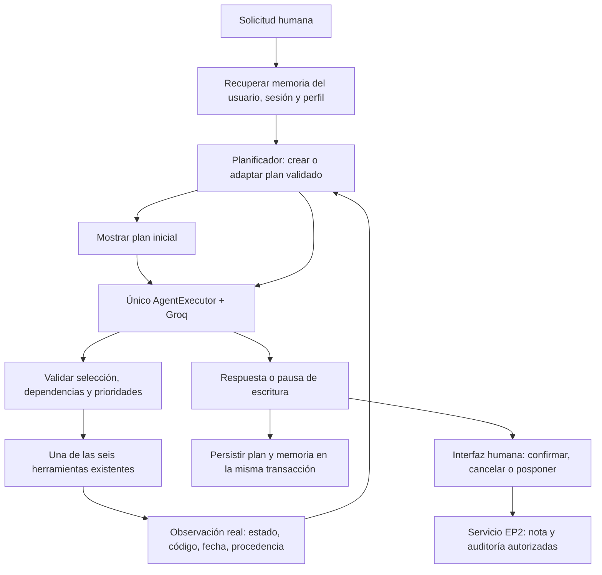

# EP2 — Etapa 4: planificación adaptativa y trazabilidad

Continuación de [Etapa 3](ep2_etapa3.md) sobre el commit estable
`8affe89f2b996dad326a8eba9dd531552c2dd431`. El estado inicial de Git estaba limpio,
en `master`, con 257 pruebas aprobadas. No se modifican EP1, el ITSM, FAISS,
embeddings, umbrales, dependencias ni credenciales.

## Arquitectura y ejecución

```powershell
python -m src.ep2.cli --usuario agente_demo --sesion caso_vpn --perfil agente
```

La CLI muestra el plan antes de llamar a Groq, observaciones, cambios y plan final.
Para continuar tras `/salir`, usar los mismos identificadores y perfil. Ejemplo:

1. «Consulta el ticket INC-2026-0411 y su SLA. Busca el procedimiento documentado
   para conectar la VPN corporativa con FortiClient y verificar el acceso a los
   recursos internos. No propongas notas todavía.»
2. «Ahora hay varios usuarios afectados. Reevalúa el impacto reportado del mismo
   ticket, distingue prioridad registrada y propuesta y propón una nota de
   seguimiento. No he confirmado ninguna escritura.»
3. En el campo humano, escribir `POSPONER` y luego `/salir`.
4. Reabrir la misma sesión: «Retoma el plan pendiente y muestra su estado desde
   la memoria, sin ejecutar acciones ni preparar nuevas notas.»

`POSPONER` conserva el estado pendiente y no invoca la API de confirmación.
`CONFIRMAR` sigue siendo el evento humano explícito; otra respuesta cancela.
EOF/interrupción en ese campo cancelan como antes. Después de reiniciar se
necesita una nueva vista previa: no se recuperan tokens de autorización.



El nuevo controlador `Planificador` no llama al LLM ni ejecuta herramientas.
Declara un plan inicial con plantillas pequeñas basadas en las verificaciones
solicitadas; Groq selecciona las herramientas dentro de esas restricciones.
La selección y ejecución siguen en el mismo `AgentExecutor`; no hay otro bucle
ni un segundo agente que repita acciones.

El adaptador `bind_tools` comunica los pasos ejecutables de mayor prioridad
en una instrucción final del servidor. Conserva los seis esquemas registrados:
Groq puede ignorar una selección por nombre y rechaza llamadas a herramientas
omitidas del esquema antes de que LangChain pueda corregirlas. Mantener el
registro permite devolver el rechazo de dependencias al mismo ejecutor, sin
ejecutar la acción. No se desactiva la validación de herramientas del proveedor.
La selección nativa se mantiene automática, como en Etapa 2; se descartó forzar
una función tras observar HTTP 400 en Groq. El modelo genera los argumentos y
selecciona la herramienta; el servidor rechaza decisiones que incumplan el plan
y devuelve una corrección dentro del presupuesto. Sin pasos disponibles permite responder sin
herramientas. Las solicitudes simples conservan la selección flexible de Etapa 2.
La validación local exige siempre prioridades, dependencias y permisos.

Para solicitudes simples se permite sustituir una lectura prevista por la
lectura elegida por el modelo, registrando la cancelación del candidato original.
Las herramientas de activo/triage comprueban el ticket internamente. Para flujos
con varias verificaciones, las dependencias previstas son obligatorias. Una
propuesta de nota no puede adelantarse a ellas ni aparecer sin petición actual.

## Contratos y transiciones

`PlanEjecucion` contiene UUID, objetivo resumido, revisión y fechas, ticket,
pasos, observaciones, cambios, impacto reportado y prioridades registrada/propuesta.
Cada `PasoPlan` contiene identificador, herramienta, prioridad (1 es mayor),
dependencias, estado, motivo breve, código, fecha e intentos.
La prioridad de paso 1–5 ordena verificaciones; es distinta de la prioridad
registrada/propuesta P1–P4 del incidente.

Pydantic valida identificadores únicos, herramientas permitidas, prioridad 1–5,
dependencias existentes, ausencia de ciclos y dependencias completadas para
pasos en ejecución/completados. El controlador revalida el grafo al actualizarlo;
no confía en `model_copy` como validación ni acepta estados generados por el LLM.

| Estado | Condición |
|---|---|
| `pendiente` | Verificación prevista; aún no ejecutada. |
| `en_ejecucion` | Dependencias y prioridad satisfechas, antes de invocar la herramienta. |
| `completado` | Resultado real `ok`; para notas, recibo de confirmación humana. |
| `bloqueado` | Error, dato faltante, permiso, límite, dependencia fallida o espera de confirmación. |
| `cancelado` | Cancelación humana de nota o sustitución de una lectura candidata en una solicitud simple. |

Una respuesta del modelo que diga «terminé» no completa pasos. En un flujo
estructurado, si quedan verificaciones disponibles, se pide corregir la decisión
dentro del mismo presupuesto del ejecutor. Una nota prematura se rechaza antes
de invocar su herramienta, evitando que `return_direct` corte el flujo sin las
verificaciones. Los rechazos de planificación se distinguen como observaciones
del sistema; el nombre de una herramienta en una traza rechazada no acredita
que se haya ejecutado.

En LangChain 0.3, el formateador original del scratchpad omite la observación
de `_Exception`. El adaptador conserva el formato original de herramientas y
añade únicamente la última corrección del servidor con los pasos disponibles;
omite el log inválido del modelo y correcciones obsoletas. No agrega llamadas
ni amplía el presupuesto del ejecutor.

Cada paso se ejecuta como máximo una vez por turno. Un reintento de lectura
bloqueada requiere una petición posterior explícita y admite hasta dos intentos
por paso. Un nuevo reporte de impacto inicia una revalidación con presupuesto
nuevo. No se repiten automáticamente acciones ante errores.

## Adaptación verificable

| Condición | Cambio de plan |
|---|---|
| Reporte de varios usuarios afectados | Observación `usuario:reporte_no_verificado`; reabrir ticket, SLA, triage y sus dependientes, priorizando las verificaciones de impacto. |
| Ticket/dato no encontrado | Bloquear el paso y descendientes; no preparar una nota dependiente. Un identificador corregido permite un plan nuevo. |
| Procedimiento no encontrado | Bloquear la nota dependiente y añadir/priorizar el triage para recomendar seguimiento Nivel 2; no inventar procedimiento. |
| Error de herramienta/proveedor | Conservar resultados anteriores y bloquear pendientes; reanudación posterior controlada. |
| Límite de iteraciones/tiempo | Bloquear pendientes con `LIMITE_EJECUCION`; no ejecutar una cola adicional fuera del presupuesto. |
| Solo mostrar el estado | No reabrir lecturas bloqueadas ni permitir ejecutar herramientas. |

El parser de impacto reconoce reportes explícitos como «varios usuarios afectados»
o «8 usuarios afectados» y evita una negación inmediata. Es una regla acotada,
no una medición real de afectados ni comprensión universal del lenguaje.

El ticket verificado INC-2026-0411 es CAT-RED, «Advertencia de certificado al
conectar la VPN», estado escalado, nivel 2 y prioridad registrada **P2**. La tabla
SLA P2 describe grupos de usuarios sin servicio; sus tiempos son 30 min / 8 h.
La propuesta **P2** solo se emite al obtener esa evidencia del SLA y queda sujeta
a verificar el reporte. No se deduce P1 por el número de usuarios: el catálogo
exige otras condiciones de criticidad. Si falta esa evidencia, no se inventa una
prioridad propuesta. Ninguna prioridad del ITSM se modifica.

La política del caso requiere escalar advertencias de certificado a Nivel 2.
El prompt EP2 lo explicita para evitar instrucciones inventadas de generación,
renovación o instalación de certificados. La selección de un archivo en FAISS
no acredita fidelidad de cada frase generada; la calidad semántica requiere una
evaluación más amplia.

## Persistencia, privacidad y escritura

`EstadoMemoria.plan` conserva el plan en el mismo snapshot SQLite de Etapa 3.
No se cambia el esquema de notas/auditoría ni se introduce una segunda base.
Las actualizaciones siguen usando `BEGIN IMMEDIATE`; una revisión antigua o
divergente del mismo plan no puede sobrescribir una más reciente.

Se mantiene un plan activo por contexto, con máximo 12 pasos, 20 observaciones
y 30 cambios recientes, dentro de los límites de memoria existentes. El contexto
del modelo recibe una proyección compacta; la CLI y SQLite conservan las fechas,
motivos y procedencia. No es un archivo histórico ilimitado de todos los planes.
Si el snapshot no cabe en la configuración de memoria, se informa el fallo de
persistencia; no se ignoran sus límites.

Tras reiniciar, una lectura interrumpida se puede retomar como pendiente. Las
notas bloqueadas por confirmación conservan esa necesidad, sin solicitud, huella,
UUID de operación ni cuerpo de nota en el plan. Un nuevo plan, reporte de impacto
o nueva propuesta descarta las vistas previas antiguas de la instancia viva.
Las notas ya registradas y su auditoría no se borran. El LLM nunca puede invocar
`confirmar_nota`; replanificar no equivale a confirmar.

Observaciones y motivos se derivan de códigos/resultados y reglas del servidor,
no del razonamiento interno del modelo. Se omiten cuerpos de notas y documentos,
y se conservan los guardarraíles y el aislamiento por usuario/sesión/perfil.
Una falla de memoria conserva el último snapshot y muestra un aviso, como en
Etapa 3. La CLI sigue siendo local y sin autenticación empresarial.

## Validación, evidencia e indicadores

```powershell
python -m pytest -q
python -m pip check
# Real: tres procesos CLI y pausas de 60 s entre fases para respetar la cuota.
python -m eval.check_ep2_plan
```

Las pruebas automáticas usan modelos guionados con el ciclo real de LangChain y
SQLite temporal. Verifican grafo, prioridades, transiciones, replanificación,
recuperación, aislamiento, límites, errores y ausencia de escritura no autorizada.
La prueba manual usa Groq y FAISS reales, con SQLite temporal y entrada humana
guionada. Conserva todos los intentos, incluidos errores, en
`.cache/ep2_plan_real.json`, excluido de Git. Los resultados medidos, planes antes
y después y limitaciones están en [la evidencia real](evidencias/ep2_plan_real.md).
Por la cuota observada, el verificador manual usa además un limitador de 35 s
entre llamadas LLM y un presupuesto de 300 s por fase; reutiliza el componente
`InMemoryRateLimiter` ya instalado. Se pueden configurar con
`--intervalo-llm-segundos` y `--pausa-segundos`. No cambia `.env`, el modelo,
la clave ni los límites predeterminados de producción (90 s por ciclo).

Resultado al cerrar esta revisión: **308 pruebas automáticas aprobadas** y
`pip check` sin conflictos. La prueba real integral **no está aprobada**: en la
última corrida real el agente completó ticket/SLA/FAISS, adaptó el plan y reconsultó el ticket,
pero Groq devolvió HTTP 429 por su cuota de 200.000 tokens diarios. No llegó a
preparar la nota. El plan se recuperó desde SQLite en otro proceso; la respuesta
del LLM también fue impedida por cuota. Se detuvieron las llamadas reales.
Los límites de ejecución y las pausas no garantizan disponibilidad del proveedor.
La evidencia distingue versiones intermedias de la implementación final.
Dos correcciones posteriores de reanudación de nota e invalidación de vista
previa ante fallo del modelo se verificaron automáticamente; no se hicieron
nuevas llamadas reales tras el bloqueo de cuota.

| Indicador | Evidencia de Etapa 4 |
|---|---|
| IE5 | Plan tipado, prioridad y dependencias ejecutables; transiciones por resultados reales; adaptación y continuidad persistente. |
| IE7 | Evidencia real parcial de cambio de plan y decisiones ante límites; prioridad propuesta separada. La demostración integral hasta nota pendiente y respuesta tras reinicio queda por validar con cuota disponible. |

Referencias técnicas consultadas el 15 de octubre de 2026:

- Groq. (s. f.). [API Reference](https://console.groq.com/docs/api-reference).
  Define `tool_choice` por nombre, `required` y modo sin herramientas.
- Groq. (s. f.). [Local Tool Calling](https://console.groq.com/docs/tool-use/local-tool-calling).
  Describe ejecución local y validación de llamadas, incluidos rechazos HTTP 400.
  Esa documentación no identifica por sí sola la causa de un error concreto;
  los resultados de esta implementación se acreditan con la prueba real.

Archivos nuevos: `src/ep2/planificacion.py`, `tests/test_ep2_planificacion.py`,
`eval/check_ep2_plan.py`, este documento y `docs/evidencias/ep2_plan_real.md`.
Modificados: contratos, agente, memoria, CLI y servicio de herramientas EP2,
`src/ep2/__init__.py` y `README.md`. Durante la implementación no se realizaron
commits ni push; el respaldo local fue autorizado posteriormente.

Limitaciones adicionales: reglas de planificación deliberadamente acotadas,
un ticket y un plan activo por contexto, capacidad limitada, tiempos cooperativos
de Etapa 2, cuotas de Groq y recuperación semántica imperfecta ya documentada.
No se ejecuta un escalamiento en un ITSM externo ni se cambia su prioridad.
El desarrollo se detiene en Etapa 4; no incluye la entrega final de Etapa 5.
Documento técnico preparado con ayuda de IA; las conclusiones, justificaciones
y reflexiones académicas corresponden a los estudiantes según la pauta.
