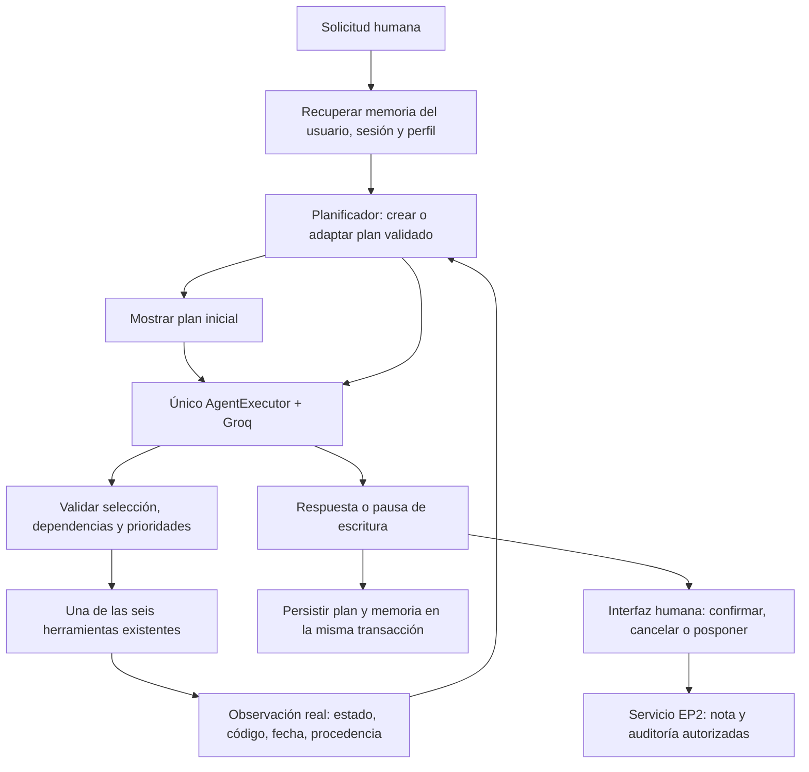

# EP2 — Etapa 4: planificación adaptativa y trazabilidad

**Estado al 22 de octubre de 2026: cierre técnico validado.** La evaluación
integral real aprobó **15/15 verificaciones en una sola ejecución**, con las fases
inicial, impacto y reanudar aprobadas, 10 solicitudes HTTP 200 y **18.137 tokens
informados por Groq**. La suite automatizada contiene **584 pruebas aprobadas**.
Ver [el cierre y sus garantías](#cierre-técnico--evaluación-integral-real-del-22-de-octubre-de-2026)
y [la evidencia versionable sanitizada](evidencias/ep2_etapa4_cierre_tecnico.md).
Los apartados fechados conservan la evolución y los bloqueos históricos; no se
combinan sus intentos parciales con la ejecución de cierre.

Continuación de [Etapa 3](ep2_etapa3.md) sobre el commit estable
`8affe89f2b996dad326a8eba9dd531552c2dd431`. El estado inicial de Git estaba limpio,
en `master`, con 257 pruebas aprobadas. No se modifican EP1, el ITSM, FAISS,
embeddings, umbrales, dependencias ni credenciales.

## Arquitectura y ejecución

```powershell
python -m src.ep2.cli --usuario agente_demo --sesion caso_vpn --perfil agente
```

La CLI muestra el plan antes de llamar a Groq, observaciones, cambios y plan final.
Para continuar tras `/salir`, usar los mismos identificadores y perfil. Ejemplo:

1. «Consulta el ticket INC-2026-0411 y su SLA. Busca el procedimiento documentado
   para conectar la VPN corporativa con FortiClient y verificar el acceso a los
   recursos internos. No propongas notas todavía.»
2. «Ahora hay varios usuarios afectados. Reevalúa el impacto reportado del mismo
   ticket, distingue prioridad registrada y propuesta y propón una nota de
   seguimiento. No he confirmado ninguna escritura.»
3. En el campo humano, escribir `POSPONER` y luego `/salir`.
4. Reabrir la misma sesión: «Retoma el plan pendiente y muestra su estado desde
   la memoria, sin ejecutar acciones ni preparar nuevas notas.»

`POSPONER` conserva el estado pendiente y no invoca la API de confirmación.
`CONFIRMAR` sigue siendo el evento humano explícito; otra respuesta cancela.
EOF/interrupción en ese campo cancelan como antes. Después de reiniciar se
necesita una nueva vista previa: no se recuperan tokens de autorización.



El nuevo controlador `Planificador` no llama al LLM ni ejecuta herramientas.
Declara un plan inicial con plantillas pequeñas basadas en las verificaciones
solicitadas; Groq selecciona las herramientas dentro de esas restricciones.
La selección y ejecución siguen en el mismo `AgentExecutor`; no hay otro bucle
ni un segundo agente que repita acciones.

El adaptador `_ModeloPlanificado` recalcula una oferta pura antes de cada
decisión del mismo `AgentExecutor`. Intersecta los pasos habilitados por
`disponibles()` con los permisos del contexto y enlaza mediante `bind_tools`
exclusivamente ese subconjunto. El ejecutor conserva las seis implementaciones;
el registro de ejecución y los esquemas visibles al modelo son independientes.
Cada resultado actualiza el plan antes de calcular la siguiente oferta. No se
invoca `preparar()` anticipadamente ni se ejecuta una cola fija de herramientas.

Para acciones obligatorias de un plan estructurado se usa `tool_choice="required"`
si la firma del adaptador del modelo admite esa opción. No se fuerza una función
por nombre. Se solicita `parallel_tool_calls=False` cuando la firma lo admite y
se sigue validando exactamente una selección localmente. `ChatOpenAI 0.3.35`
admite ambas opciones; una firma que no las acepta recibe solo los esquemas.
La evaluación integral del 22 de octubre acreditó esos parámetros con la nueva
proyección: todas sus respuestas fueron HTTP 200. No hay prueba de red previa,
reintento ni fallback automático a los seis
esquemas si el proveedor falla. Su validación de herramientas permanece activa.

La oferta vacía distingue `plan_completado`, `solo_estado`, `plan_bloqueado` y
`sin_permisos`. Los dos primeros permiten responder sin esquemas; los dos últimos
detienen el ciclo con error o denegación del servidor, sin llamar al modelo para
que declare éxito. La traza indica si hubo respuesta del modelo; una decisión de
detención del servidor no equivale a una solicitud HTTP.

Para solicitudes simples se permite sustituir una lectura prevista por la
lectura elegida por el modelo, registrando la cancelación del candidato original.
Las herramientas de activo/triage comprueban el ticket internamente. Para flujos
con varias verificaciones, las dependencias previstas son obligatorias. Una
propuesta de nota no puede adelantarse a ellas ni aparecer sin petición actual.
En este modo flexible se ofrecen lecturas independientes permitidas, conservando
los requisitos de los pasos existentes y excluyendo pasos completados o bloqueados.
No se impone `required`. En particular, un triage independiente puede consultar
ticket y SLA internamente; en la reevaluación estructurada no se ofrece análisis
hasta que esos pasos del plan estén completados. El filtro no cambia el grafo.

Las trazas en RAM y su evidencia sanitizada incluyen `herramientas_ofrecidas`,
`estado_oferta` y `tool_choice`, además de selección, resultado y plan antes/después.
Solo guardan nombres conocidos y estados enumerados; no payloads completos,
argumentos, cuerpos de notas, credenciales ni razonamiento del modelo. El evaluador
conserva esos campos mediante una lista permitida y mantiene los 15 criterios.

La prueba integral con cliente OpenAI y HTTP simulado inspecciona estas ofertas:

| Fase | Esquemas sucesivos en `request.tools` |
|---|---|
| Inicial | `[consultar_ticket]` → `[consultar_sla]` → `[buscar_procedimiento]` → sin herramientas |
| Impacto | `[consultar_ticket]` → `[consultar_sla]` → `[analizar_incidente]` → `[buscar_procedimiento]` → `[registrar_nota_ticket]` |
| Reanudar | Sin herramientas; recupera el plan desde la misma SQLite temporal |

Son respuestas guionadas sobre ITSM y RAG de prueba; no acreditan obediencia de
Groq ni una validación real 15/15. Con la proyección por paso, los resultados
pertinentes se envían como observaciones fechadas; el scratchpad queda interno al
ejecutor. Se comprueban los límites globales,
`POSPONER`, cero notas/auditoría y la detención ante 400 sin reintentos. Una segunda
prueba simula un proveedor que devuelve una selección excluida con HTTP 200: la
validación local sigue impidiendo su ejecución y conserva el límite de ocho.

Riesgo residual: Groq puede generar una herramienta omitida y devolver HTTP 400.
El filtrado evita ofrecer una herramienta prematura, pero no garantiza una
generación válida para toda entrada. La integral de cierre aprobó 15/15 con la
proyección por paso; la validación del proveedor permanece activa y no se amplían
presupuesto o iteraciones para ocultar un rechazo.

Validación local del filtrado, 20 de octubre de 2026: **403 pruebas aprobadas**
(17 casos adicionales sobre las 386 anteriores), con sockets de red bloqueados,
`pip check` correcto y `git diff --check` sin errores. La simulación integral
aprueba sus 15 verificaciones con 10 solicitudes HTTP simuladas; sus PID se
sustituyen en la prueba del padre y se usa SQLite temporal. En esa fecha aún no
se había ejecutado la integral real con la proyección posterior. Se preserva la
evidencia real anterior. La recuperación también se prueba con nuevas instancias de agente y
almacenamiento sobre la misma SQLite de prueba.

## Contratos y transiciones

`PlanEjecucion` contiene UUID, objetivo resumido, revisión y fechas, ticket,
pasos, observaciones, cambios, impacto reportado y prioridades registrada/propuesta.
Cada `PasoPlan` contiene identificador, herramienta, prioridad (1 es mayor),
dependencias, estado, motivo breve, código, fecha e intentos.
La prioridad de paso 1–5 ordena verificaciones; es distinta de la prioridad
registrada/propuesta P1–P4 del incidente.

Pydantic valida identificadores únicos, herramientas permitidas, prioridad 1–5,
dependencias existentes, ausencia de ciclos y dependencias completadas para
pasos en ejecución/completados. El controlador revalida el grafo al actualizarlo;
no confía en `model_copy` como validación ni acepta estados generados por el LLM.

| Estado | Condición |
|---|---|
| `pendiente` | Verificación prevista; aún no ejecutada. |
| `en_ejecucion` | Dependencias y prioridad satisfechas, antes de invocar la herramienta. |
| `completado` | Resultado real `ok`; para notas, recibo de confirmación humana. |
| `bloqueado` | Error, dato faltante, permiso, límite, dependencia fallida o espera de confirmación. |
| `cancelado` | Cancelación humana de nota o sustitución de una lectura candidata en una solicitud simple. |

Una respuesta del modelo que diga «terminé» no completa pasos. En un flujo
estructurado, si quedan verificaciones disponibles, se pide corregir la decisión
dentro del mismo presupuesto del ejecutor. Una nota prematura se rechaza antes
de invocar su herramienta, evitando que `return_direct` corte el flujo sin las
verificaciones. Los rechazos de planificación se distinguen como observaciones
del sistema; el nombre de una herramienta en una traza rechazada no acredita
que se haya ejecutado.

En LangChain 0.3, el formateador original del scratchpad omite la observación
de `_Exception`. El adaptador conserva el formato original de herramientas y
añade únicamente la última corrección del servidor con los pasos disponibles;
omite el log inválido del modelo y correcciones obsoletas. No agrega llamadas
ni amplía el presupuesto del ejecutor.

Cada paso se ejecuta como máximo una vez por turno. Un reintento de lectura
bloqueada requiere una petición posterior explícita y admite hasta dos intentos
por paso. Un nuevo reporte de impacto inicia una revalidación con presupuesto
nuevo. No se repiten automáticamente acciones ante errores.

## Adaptación verificable

| Condición | Cambio de plan |
|---|---|
| Reporte de varios usuarios afectados | Observación `usuario:reporte_no_verificado`; reabrir ticket, SLA, triage y sus dependientes, priorizando las verificaciones de impacto. |
| Ticket/dato no encontrado | Bloquear el paso y descendientes; no preparar una nota dependiente. Un identificador corregido permite un plan nuevo. |
| Procedimiento no encontrado | Bloquear la nota dependiente y añadir/priorizar el triage para recomendar seguimiento Nivel 2; no inventar procedimiento. |
| Error de herramienta/proveedor | Conservar resultados anteriores y bloquear pendientes; reanudación posterior controlada. |
| Límite de iteraciones/tiempo | Bloquear pendientes con `LIMITE_EJECUCION`; no ejecutar una cola adicional fuera del presupuesto. |
| Solo mostrar el estado | No reabrir lecturas bloqueadas ni permitir ejecutar herramientas. |

El parser de impacto reconoce reportes explícitos como «varios usuarios afectados»
o «8 usuarios afectados» y evita una negación inmediata. Es una regla acotada,
no una medición real de afectados ni comprensión universal del lenguaje.

El ticket verificado INC-2026-0411 es CAT-RED, «Advertencia de certificado al
conectar la VPN», estado escalado, nivel 2 y prioridad registrada **P2**. La tabla
SLA P2 describe grupos de usuarios sin servicio; sus tiempos son 30 min / 8 h.
La propuesta **P2** solo se emite al obtener esa evidencia del SLA y queda sujeta
a verificar el reporte. No se deduce P1 por el número de usuarios: el catálogo
exige otras condiciones de criticidad. Si falta esa evidencia, no se inventa una
prioridad propuesta. Ninguna prioridad del ITSM se modifica.

La política del caso requiere escalar advertencias de certificado a Nivel 2.
El prompt EP2 lo explicita para evitar instrucciones inventadas de generación,
renovación o instalación de certificados. La selección de un archivo en FAISS
no acredita fidelidad de cada frase generada; la calidad semántica requiere una
evaluación más amplia.

## Persistencia, privacidad y escritura

`EstadoMemoria.plan` conserva el plan en el mismo snapshot SQLite de Etapa 3.
No se cambia el esquema de notas/auditoría ni se introduce una segunda base.
Las actualizaciones siguen usando `BEGIN IMMEDIATE`; una revisión antigua o
divergente del mismo plan no puede sobrescribir una más reciente.

Se mantiene un plan activo por contexto, con máximo 12 pasos, 20 observaciones
y 30 cambios recientes, dentro de los límites de memoria existentes. El contexto
del modelo recibe una proyección compacta; la CLI y SQLite conservan las fechas,
motivos y procedencia. No es un archivo histórico ilimitado de todos los planes.
Si el snapshot no cabe en la configuración de memoria, se informa el fallo de
persistencia; no se ignoran sus límites.

Tras reiniciar, una lectura interrumpida se puede retomar como pendiente. Las
notas bloqueadas por confirmación conservan esa necesidad, sin solicitud, huella,
UUID de operación ni cuerpo de nota en el plan. Un nuevo plan, reporte de impacto
o nueva propuesta descarta las vistas previas antiguas de la instancia viva.
Las notas ya registradas y su auditoría no se borran. El LLM nunca puede invocar
`confirmar_nota`; replanificar no equivale a confirmar.

Observaciones y motivos se derivan de códigos/resultados y reglas del servidor,
no del razonamiento interno del modelo. Se omiten cuerpos de notas y documentos,
y se conservan los guardarraíles y el aislamiento por usuario/sesión/perfil.
Una falla de memoria conserva el último snapshot y muestra un aviso, como en
Etapa 3. La CLI sigue siendo local y sin autenticación empresarial.

## Validación, evidencia e indicadores

```powershell
python -m pytest -q
python -m pip check
# Real: ejecutar solo con autorización expresa y cuota disponible.
.\.venv\Scripts\python.exe -m eval.check_ep2_plan --max-solicitudes 14 --presupuesto-tokens 80000 --max-tokens-salida 2000 --segundos-fase 300 --timeout-llm 30 --timeout-proceso 360 --intervalo-llm-segundos 35 --pausa-segundos 60
```

Las pruebas automáticas usan modelos guionados con el ciclo real de LangChain y
SQLite temporal. Verifican grafo, prioridades, transiciones, replanificación,
recuperación, aislamiento, límites, errores y ausencia de escritura no autorizada.
La prueba manual usa Groq y FAISS reales, con SQLite temporal y entrada humana
guionada. La evidencia histórica permanece intacta en `.cache/ep2_plan_real.json`.
El evaluador controlado registra sus intentos en `.cache/ep2_plan_controlado.json`,
también excluido de Git. Los resultados históricos medidos y sus limitaciones
están en [la evidencia histórica](evidencias/ep2_plan_real.md); el resultado vigente
está en [el cierre técnico 15/15](evidencias/ep2_etapa4_cierre_tecnico.md).
Por la cuota observada, el verificador manual usa además un limitador de 35 s
entre llamadas LLM y un presupuesto de 300 s por fase; reutiliza el componente
`InMemoryRateLimiter` ya instalado. Se pueden configurar con
`--intervalo-llm-segundos` y `--pausa-segundos`. No cambia `.env`, el modelo,
la clave ni los límites predeterminados de producción (90 s por ciclo).

### Cierre técnico — evaluación integral real del 22 de octubre de 2026

Una ejecución autorizada de `python -m eval.check_ep2_plan` aprobó **15/15**
verificaciones, sin combinar fases de distintos intentos. Utilizó el agente real
y la nueva proyección por paso, con Groq `openai/gpt-oss-20b`, FAISS real y SQLite
EP2 temporal compartida entre tres procesos CLI distintos.

| Fase | Resultado | Solicitudes reales | Entrada informada | Salida informada | Total informado |
|---|---|---:|---:|---:|---:|
| Inicial | Aprobada: ticket, SLA y procedimiento | 4 | 4.672 | 1.040 | 5.712 |
| Impacto | Aprobada: reevaluación y una propuesta pendiente | 5 | 7.754 | 2.017 | 9.771 |
| Reanudar | Aprobada: plan y pendiente recuperados sin nuevas herramientas | 1 | 1.865 | 789 | 2.654 |
| **Total** | **15/15** | **10** | **14.291** | **3.846** | **18.137** |

Las diez respuestas fueron **HTTP 200**. Todas informaron consumo: **cero
solicitudes con estimación**; el total operativo coincidió con el informado.
Las reservas previas del evaluador no se presentan como consumo facturado.
Se mantuvieron 14 solicitudes máximas, 80.000 tokens operativos, 2.000 tokens de
salida por respuesta, 8 iteraciones por fase, 300 s por fase, 360 s por proceso,
30 s de timeout HTTP, intervalo de 35 s, pausas de 60 s y cero reintentos.

La traza registró dos mensajes por decisión y únicamente las herramientas
habilitadas. No hubo selecciones rechazadas ni incumplimientos de prioridad o
dependencias. Se conservaron identidad/revisiones del plan y memoria actualizada
en las tres fases, prioridad registrada/propuesta separadas y el impacto como
reporte no verificado. `POSPONER` dejó una propuesta pendiente; reanudar recuperó
ese bloqueo sin nueva propuesta ni autorizaciones. Se verificaron **cero notas,
cero auditorías de escritura e ITSM original intacto**.

El HTTP 400 **no se reprodujo después de incorporar la proyección en esta
ejecución**. La causa del rechazo histórico no quedó demostrada y no se garantiza
ausencia de errores para cualquier entrada o disponibilidad futura de Groq.
La aceptación técnica de Etapa 4 queda cerrada; Etapa 5 permanece fuera de alcance.

La [evidencia sanitizada versionable](evidencias/ep2_etapa4_cierre_tecnico.md)
incluye las quince comprobaciones, fases, ensayos aislados, límites y huellas de
las fuentes evaluadas. Se deriva solo del intento completo aprobado del reporte
local ignorado, sin copiar prompts, claves, argumentos, razonamientos ni datos de
negocio. La suite de **584 pruebas con red bloqueada** se distingue de esas
solicitudes reales y de los controles aislados de una sola decisión.

### Diagnóstico aislado de la primera decisión de impacto

Este modo está preparado para una futura llamada real **solo con autorización**.
No se ejecutó Groq durante su implementación ni se considera aprobada la integral.

Desde la raíz del repositorio:

```powershell
.\.venv\Scripts\python.exe -m eval.check_ep2_plan --diagnostico-impacto
```

El comando consume cuota. Solo admite las opciones adicionales `--tool-choice-explicito`,
`--contexto-minimo` y `--contexto-plan` descritas más abajo; rechaza combinaciones con `--fase`, `--directorio` o los
parámetros de límites de la integral. Sus valores son fijos:

| Parámetro | Valor del ensayo |
|---|---|
| Modelo | `openai/gpt-oss-20b` |
| Oferta | Solo `consultar_ticket`, con el esquema real del agente |
| Selección original | `tool_choice="required"`, `parallel_tool_calls=False` |
| Máximo de envíos | **1**, incluso ante error o intento concurrente |
| Reintentos | 0 en SDK y transporte; sin redirecciones |
| Máximo de salida | 2.000 tokens |
| Timeout HTTP | 30 segundos |
| Presupuesto operativo previo | 20.000: bytes del payload + 256 + reserva de salida |

El presupuesto es una estimación conservadora, no consumo real ni facturación.
Si la solicitud no cabe o sus parámetros/destino serializados no coinciden con
el ensayo, se bloquea antes de enviarla. Solo admite el endpoint HTTPS de chat
de Groq configurado normalmente; no admite proxies del entorno ni otro destino.
La temperatura procede de la configuración habitual y queda registrada.

La preparación crea una SQLite **temporal** bajo `.cache/ep2-diagnostico-*`.
Usa los contratos, memoria y planificador reales con datos **inventados** de
ticket P2, SLA y una referencia documental, sin consultar ITSM ni FAISS.
Fechas, identificador del plan e intercambio ficticio están fijados para repetir
la solicitud con la misma configuración. Las observaciones simulan el final de
la fase inicial; no son evidencia de herramientas ejecutadas ni fuentes consultadas.
El reporte identifica explícitamente `fixture_ficticio_v1_no_replay_historico`.

El plan completado se recupera y reabre mediante el planificador real. Se arma
el prompt de impacto con memoria textual y scratchpad vacío, reutilizando el
adaptador `_ModeloPlanificado`. Se invoca únicamente ese modelo enlazado:
**no se crea `AgentExecutor` ni se interpreta la respuesta para despachar herramientas**.
Aunque Groq devuelva una llamada válida, no se consulta el ticket, no se prepara
una nota, no se confirma nada y no se continúa a SLA, análisis o reapertura.
Los conectores del ensayo están bloqueados y se comprueba que notas/auditoría
temporales sigan en cero y las bases originales conserven sus huellas.

Se agrega un intento separado en `.cache/ep2_diagnostico_impacto.json`, excluido
de Git. No modifica los históricos `ep2_plan_real.json` ni `ep2_plan_controlado.json`.
Conserva fecha, límites, temperatura, versiones, hashes del código, estructura
del plan, metadatos HTTP sanitizados y contadores de integridad. De una respuesta
200 solo conserva cantidad de llamadas válidas/ilegibles, selección conocida o
`fuera_registro`, un booleano de validación de argumentos y `finish_reason` permitido.
Los argumentos se validan en RAM y se descartan; no se guarda el identificador
devuelto ni el contenido libre de la respuesta. No se almacenan payloads completos,
prompts enviados, cuerpos HTTP, notas, claves, razonamientos ni contenido de
`failed_generation`. El logging se inhibe durante preparación/llamada y se restaura
al salir, igual que debug/verbose de LangChain. La caché del modelo se desactiva
para evitar persistir prompts o reutilizar respuestas; LangSmith se desactiva
también por contexto, incluso si estaba habilitado.
La SQLite ficticia y el contador temporal se eliminan al cerrar el ensayo.

Interpretación:

- Salida **0**, `DECISION_VALIDA_SIN_EJECUTAR`: llegó una única llamada a
  `consultar_ticket` con argumentos válidos para el caso ficticio. **No se ejecutó**.
  No demuestra que el HTTP 400 histórico esté resuelto ni equivale a 15/15.
- Salida **1**, `RESPUESTA_NO_VALIDA`: hubo texto sin llamada, selección distinta,
  varias llamadas o argumentos inválidos. Se conservan solo indicadores estructurales.
- Salida **1**, `ERROR_HTTP`: revisar estado, código/tipo y categoría sanitizada;
  un 400 puede quedar en `NO_CLASIFICADO`, sobre todo si el detalle solo está en
  `failed_generation`. No se intenta recuperar ese contenido.
- Salida **1**, `HTTP_429` o `ERROR_TRANSPORTE`: cuota o fallo sin respuesta,
  respectivamente; no se reintenta y no demuestra una causa del 400.
- Una preparación/evidencia inválida sale con **1** y puede no enviar solicitudes;
  la interrupción capturada usa **130** y argumentos CLI inválidos, **2**.

El payload histórico exacto no está disponible. El ensayo ofrece una reproducción
controlada de la situación, con memoria ficticia comparable; una respuesta 200 no
cierra Etapa 4. Sigue siendo necesaria una corrida real única de tres procesos,
con 15/15 y todas las garantías de integridad y confirmación humana.

Validación local de la preparación original: **468 pruebas aprobadas**, incluidas 29
nuevas para el modo aislado, con conexiones/DNS/envíos de red bloqueados por un
audit hook de Python y **cero intentos de red**. Se comprobaron respuestas simuladas
200/400/429/500, redirección, timeout, interrupción, concurrencia, límites fijos,
ausencia de ejecución de herramientas y escrituras de negocio, reproducibilidad
y descarte de contenido sensible incluso con debug, trazas y caché habilitados
externamente. `pip check` y `git diff --check` también pasaron. Esta evidencia es
local y simulada; no constituye una nueva evaluación real de Groq.

#### Variante con selección explícita

El modo original se conserva con `tool_choice="required"`. La nueva opción elige
una función concreta mediante el objeto de **Chat Completions**:

```json
{"type": "function", "function": {"name": "consultar_ticket"}}
```

La [referencia de Groq](https://console.groq.com/docs/api-reference) y su guía de
[selección de herramientas](https://console.groq.com/docs/tool-use/local-tool-calling)
documentan este formato. La [ficha de GPT OSS 20B](https://console.groq.com/docs/model/openai/gpt-oss-20b)
incluye function calling, sin una excepción documentada a esta selección. Se
comprobó que `ChatOpenAI.bind_tools` del cliente instalado acepta el diccionario
y que el SDK OpenAI lo tipa como `ChatCompletionNamedToolChoiceParam`.
Esto acredita el formato documentado, sin garantizar una generación válida.

Comando de la variante, **no ejecutarlo sin nueva autorización**:

```powershell
.\.venv\Scripts\python.exe -m eval.check_ep2_plan --diagnostico-impacto --tool-choice-explicito
```

`--tool-choice-explicito` requiere `--diagnostico-impacto`; no activa la integral.
Cada invocación tiene un límite independiente de **un envío**, sin reintentos,
redirecciones, fallback al modo original ni ejecución de herramientas. Mantiene
modelo, temperatura, prompt, memoria ficticia, esquema de `consultar_ticket`,
`parallel_tool_calls=False`, salida de 2.000 tokens y timeout de 30 segundos.
Un adaptador local del evaluador sustituye únicamente `tool_choice` al enlazar
el modelo real; no modifica el agente ni el planificador. El transporte comprueba
el objeto exacto antes de enviar: rechaza nombres, formatos o campos adicionales.
Las pruebas comparan los dos payloads serializados y exigen que su única
diferencia sea `tool_choice`.

La variante agrega sus intentos en `.cache/ep2_diagnostico_impacto_explicito.json`,
también ignorado por Git. El histórico original y las evaluaciones integrales se
conservan intactos. El reporte incluye `variante="funcion_explicita"`; los nuevos
intentos del modo original llevan `variante="required"`. La observabilidad HTTP
registra `tool_choice="funcion"` y `funcion_elegida="consultar_ticket"`, siempre
con la misma lista permitida y sin prompts, argumentos ni contenido del proveedor.

La ejecución real previa del modo original devolvió 400,
`HERRAMIENTA_NO_OFRECIDA`, `tool_use_failed` / `invalid_request_error`, con un envío
y cero herramientas/escrituras. Es el punto de comparación, no una evaluación
integral aprobada. Para la variante, 200 con una llamada válida termina con 0
sin ejecutar nada; 200 inválido, 400 y 429 terminan con 1 sin continuar ni reintentar.
Un 200 respaldaría que la selección explícita ayuda en este caso ficticio; no
garantizaría resolver el fallo histórico. La propia guía de Groq advierte que
seleccionar una función todavía puede dar 400 si el modelo genera otra o ninguna.
Una categoría `PARAMETROS_INVALIDOS` requeriría revisar compatibilidad; no se debe
improvisar otra solicitud. Un 429 solo aporta evidencia de cuota en ese intento.

Validación local de la variante: **505 pruebas aprobadas**, 37 casos adicionales
respecto de las 468 anteriores. Se verificaron ambos modos con red bloqueada y
cero intentos de conexión, incluyendo el objeto exacto serializado, un solo envío
ante concurrencia, errores sin reintentos, cero herramientas/escrituras y ausencia
de contenido sensible. `pip check` y `git diff --check` pasaron. Las huellas de ITSM,
memoria original, respaldos e históricos permanecieron iguales; no se ejecutó
ninguna llamada real durante esta preparación.

#### Análisis local y control con contexto mínimo

Los dos ensayos reales aislados dieron 400, `HERRAMIENTA_NO_OFRECIDA`, con código
`tool_use_failed` y tipo `invalid_request_error`: el original en 0,703 s y el
explícito en 0,844 s. Ambos ofrecieron solo `consultar_ticket`, sin herramientas
ejecutadas ni escrituras. Cambiar la selección fue insuficiente en esos intentos;
no conocemos la herramienta que intentó generar el proveedor.

La comparación local de las primeras decisiones usa el constructor de plan,
memoria y adaptador reales, sin ejecutar herramientas ni LLM. No es un replay:
el payload histórico completo de la fase inicial no se conservó. El último
histórico integral registra cuatro 200 iniciales y luego el 400 de impacto.
Las reservas de entrada permiten derivar 5.668 bytes para la primera solicitud
inicial, 9.225 para la primera de impacto y 9.969 para la última inicial exitosa
(reserva menos 256). Ese éxito con un payload mayor no respalda atribuir el 400
únicamente al tamaño. Los ensayos ficticios recientes midieron 8.335 y 8.383 bytes.

| Elemento | Primera decisión inicial reconstruida | Primera decisión de impacto ficticia |
|---|---|---|
| Sistema base | `SISTEMA_EP2` | El mismo; no explica por sí solo la diferencia |
| Oferta / selección original | Solo `consultar_ticket` / `required` | Igual |
| Mensajes con el control final | 5: system, system, system, user, system | 7: system, system, user, assistant, system, user, system |
| Objetivo del usuario | Ticket, SLA y procedimiento; sin proponer notas todavía | Revalidar varios afectados, distinguir prioridades y proponer seguimiento |
| Memoria | Aviso de memoria con estado vacío | Hechos históricos de ticket/SLA/procedimiento y un intercambio ficticio previo |
| Plan | Nuevo: ticket → SLA → procedimiento | Recuperado y reabierto: ticket → SLA → análisis; procedimiento previsto y nota sujetos a dependencias |
| Primera herramienta habilitada | `consultar_ticket` | `consultar_ticket` |
| Prioridad registrada en el contexto | Aún sin consultar | P2 recordada; debe revalidarse |

Hay una **tensión de contexto comprobable**, no una orden de saltar dependencias:
`SISTEMA_EP2` describe herramientas que no se ofrecen en esta decisión y habla
de analizar el incidente y proponer notas; el usuario de impacto pide seguimiento,
el JSON del plan enumera las acciones futuras y la memoria recuerda lecturas
que ahora deben repetirse. Esto podría inducir una selección anticipada, pero
esa influencia es una hipótesis. El sistema también ordena reconsultar ticket,
SLA y después analizar; el plan hace depender análisis de ticket+SLA y el control
final exige una sola llamada a la oferta actual. No se encontró una instrucción
que ordene analizar **antes** de consultar el ticket ni una contradicción lógica
demostrada en las dependencias. El objetivo interno `PlanEjecucion.objetivo` no
se envía en `Planificador.contexto()`; sí se envían los pasos y la solicitud humana.
El control final conserva la prioridad registrada P2 en impacto, frente a una
prioridad aún desconocida al inicio; conocer el valor histórico tampoco completa
la nueva lectura pendiente. El sistema base es común a ambas fases, por lo que
su mera presencia no identifica la causa de la diferencia de resultados.
La consulta anterior que pedía no proponer notas es historial marcado como dato,
y la petición nueva cambia ese objetivo; no autoriza escrituras. La memoria no
restaura mensajes nativos `tool_calls` del modelo.

Para aislar el contexto se agrega una tercera variante. Comando posterior, que
**requiere autorización y no se ejecutó durante esta implementación**:

```powershell
.\.venv\Scripts\python.exe -m eval.check_ep2_plan --diagnostico-impacto --tool-choice-explicito --contexto-minimo
```

Requiere ambos flags previos. Conserva modelo, temperatura, esquema y descripción
reales de `consultar_ticket`, objeto de selección explícita, llamadas paralelas
desactivadas, salida de 2.000 tokens y timeout HTTP de 30 segundos. Solo sustituye
`messages` por dos mensajes ficticios: instrucción de emitir una llamada a esa
función y consulta del identificador ficticio. No incluye `SISTEMA_EP2`, memoria,
historial, estado del plan, control del adaptador ni instrucciones sobre acciones
posteriores. Tampoco crea un plan ni recupera/guarda memoria; solo construye el
catálogo real para obtener el mismo esquema. Se crea la SQLite temporal vacía
del servicio para mantener el bloqueo de conectores y los controles de cero
notas/auditoría; no toca el ITSM ni la memoria original.

El transporte exige exactamente esos dos mensajes y la selección explícita
antes del único envío. No hay reintentos, redirecciones, fallback, herramientas,
confirmaciones ni continuación. El reporte separado es
`.cache/ep2_diagnostico_impacto_minimo.json`, con `variante="contexto_minimo"`,
`origen_sesion="control_minimo_sin_memoria_v1"` y `plan_inicial=null`. Conserva
solo la observabilidad sanitizada ya descrita, nunca prompts, argumentos,
razonamientos ni contenido de `failed_generation`. Los dos reportes anteriores
y la evaluación integral se conservan intactos.

Interpretación prevista para ese control:

- Un 200 con llamada válida mostraría que modelo+esquema+selección pueden funcionar
  con contexto mínimo en ese intento, y respaldaría investigar el contexto amplio.
  No identificaría qué parte influye ni demostraría causalidad: la generación
  puede variar y este control cambia todo el bloque de mensajes a la vez.
- El mismo 400 mostraría que el contexto amplio no es necesario para reproducir
  ese rechazo en el control. Seguirían abiertas hipótesis de generación del
  modelo, representación de llamadas, esquema/cliente y validación del proveedor;
  ninguna quedaría demostrada por descarte.
- Un 429, timeout u otra categoría necesitaría su propia interpretación y no
  resolvería la hipótesis de selección fuera de oferta. Todos los casos terminan
  tras la única solicitud, sin ejecutar herramientas. Un 200 inválido también
  termina; nunca se intenta corregir automáticamente.

No se encontró una causa concreta confirmada del HTTP 400. Este control aislado
por sí solo no cierra Etapa 4 ni sustituye la integral real 15/15 documentada
posteriormente en el cierre técnico.

Validación local: **534 pruebas aprobadas**, 29 casos adicionales respecto de
las 505 anteriores, con red bloqueada y cero intentos de conexión. Incluyen la
comparación inicial/impacto, equivalencia de los parámetros salvo `messages`,
contexto mínimo exacto, ausencia de acceso a memoria/planificador, respuestas
200/400/429, detención tras un envío y privacidad de los tres modos. `pip check`
y `git diff --check` pasaron. No hubo llamadas reales ni cambios en agente,
planificador, ITSM, memoria original, respaldos o evaluaciones anteriores.

#### Control intermedio: contexto mínimo y estado del plan

Una ejecución real posterior del control mínimo obtuvo **HTTP 200**, una llamada
válida a `consultar_ticket`, 0,531 s y consumo informado de 181 tokens de entrada
+ 223 de salida = **404 tokens**. Se detuvo sin ejecutar herramientas ni escribir
datos de negocio. Los dos controles de contexto completo habían obtenido 400.
Esto demuestra compatibilidad en ese intento de modelo+esquema+selección, y
respalda investigar el contexto; no demuestra qué mensaje causó los rechazos.

El control intermedio **obtuvo HTTP 200 con Groq**, una llamada válida a
`consultar_ticket`, 0,360 s y **654 + 54 = 708 tokens informados**. Añade al mínimo únicamente
un mensaje `system` con la salida de `Planificador.contexto()` del mismo fixture
de impacto. No es todavía la proyección por paso propuesta para producción:
incluye el plan completo que se enviaba, con sus pasos futuros, para medir su
influencia sin cambiar simultáneamente ese contenido.

| Contexto | Mensajes | Información enviada | Evidencia real disponible |
|---|---|---|---|
| Completo | 7 | Sistema general, memoria/hechos, intercambio anterior, plan, solicitud de impacto y control final | 400 con required; 400 con selección explícita |
| Mínimo | 2 | Objetivo inmediato e identificador ficticio | 200 y llamada válida; 404 tokens informados |
| Mínimo + plan | 3: system, system, user | Los mismos dos mensajes mínimos y exactamente el bloque de plan del control completo | 200 y llamada válida; 708 tokens informados |

Comando posterior, **solo con autorización nueva**:

```powershell
.\.venv\Scripts\python.exe -m eval.check_ep2_plan --diagnostico-impacto --tool-choice-explicito --contexto-plan
```

`--contexto-plan` exige diagnóstico y selección explícita; no se puede combinar
con `--contexto-minimo` ni límites/fases adicionales. Conserva modelo
`openai/gpt-oss-20b`, temperatura habitual, esquema y descripción reales de
`consultar_ticket`, objeto de selección explícita, `parallel_tool_calls=False`,
salida máxima de 2.000 tokens, timeout HTTP de 30 s y máximo **un envío**.
No hay reintentos, redirecciones, herramientas, notas, confirmaciones ni otras
fases. El transporte verifica el contexto exacto antes de enviar.

El estado se construye con el planificador real y las mismas observaciones
ficticias del control completo, simulando serialización/recuperación del plan en
RAM. No se consulta ni guarda memoria conversacional; no se incluyen historial,
`SISTEMA_EP2`, solicitud general de impacto ni el control final del adaptador.
El catálogo real se construye en la SQLite temporal protegida como en el mínimo.
El reporte separado `.cache/ep2_diagnostico_impacto_plan.json` queda ignorado por
Git, con `variante="minimo_con_plan"`, origen ficticio y estructura sanitizada
del plan. Los tres históricos anteriores permanecen intactos. No se persisten
prompts, argumentos, cuerpos HTTP, razonamientos ni contenido de `failed_generation`.

Las pruebas comparan los payloads: los parámetros y el esquema son idénticos al
mínimo; sus dos mensajes se conservan literalmente y se inserta solo un mensaje
adicional, idéntico al bloque de plan del control completo. Las dependencias
siguen haciendo que únicamente `consultar_ticket` esté disponible. Esta igualdad
no implica que se hayan consultado fuentes ni ejecutado herramientas reales.

#### Propuesta de contexto por decisión — diseño previo a la implementación

La información indispensable para **seleccionar y parametrizar** la próxima
herramienta es el objetivo inmediato, su esquema permitido, las entidades
resueltas y los hechos necesarios para sus parámetros. El servidor conserva
la autoridad sobre permisos, dependencias, prioridades y confirmaciones; esos
campos no deben deducirse de una respuesta del modelo.

| Decisión | Contexto que debe conservar la proyección |
|---|---|
| `consultar_ticket` | Identificador resuelto del pedido o memoria autorizada, procedencia y necesidad de obtener estado actual. No sustituir la lectura por hechos históricos. |
| `consultar_sla` | Prioridad recién verificada y vigencia de la observación que determina el parámetro. |
| `analizar_incidente` | Ticket actual y evidencia pertinente; el servidor ya comprobó ticket/SLA y permite el paso. |
| `buscar_procedimiento` | Tema técnico del pedido original, restricciones y referencias pertinentes. No perder, por ejemplo, la consulta VPN/FortiClient al resumir el objetivo. |
| `registrar_nota_ticket` | Petición actual de seguimiento, hechos verificados, fuentes, distinción entre prioridad registrada/propuesta e impacto reportado/verificado. Solo propuesta y pausa humana. |
| Responder o retomar sin herramientas | Hechos pertinentes con procedencia, estado/pendientes recuperados y límites de lo conocido. No forzar una llamada cuando el plan solo requiere mostrar estado. |

Propuesta previa a la implementación del compositor descrita más abajo:

1. Incorporar una función pura que proyecte el contexto de cada decisión sobre
   el plan y los hechos tipados que mantiene el servidor. Componer objetivo
   inmediato y datos pertinentes, con etiquetas de antigüedad y procedencia;
   sin instrucciones globales sobre herramientas futuras ni transcripción completa.
   No eliminar restricciones de seguridad, permisos, no inventar datos ni la
   confirmación humana. Si falta un dato obligatorio, seguir la ruta de falta de
   contexto/aclaración; no inventarlo para lograr una llamada.
2. Recalcular esa proyección en cada invocación del mismo `_ModeloPlanificado`,
   junto con la oferta real de `disponibles()` y el perfil. Una nueva observación
   de herramienta actualiza el plan antes de proyectar el siguiente paso.
   No crear otro agente ni un segundo ciclo, fijar una secuencia de ejecución o
   ampliar la oferta para aceptar una selección prematura.
3. Mantener esquemas, validación local de decisión/argumentos/dependencias,
   presupuesto, límite de iteraciones, pausa de nota y API humana de confirmación.
   La selección explícita sería candidata solo cuando la oferta obligatoria sea
   exactamente una función; las consultas flexibles y los estados sin herramientas
   conservan su tratamiento propio. No forzar siempre `consultar_ticket`.
4. Conservar el plan completo y la memoria canónica. Recuperarlos de SQLite al
   iniciar, actualizar sus objetos en RAM con resultados reales y persistirlos
   mediante `registrar_turno` y el manejo de confirmación existentes. No cambiar
   la cadencia ni la transacción de persistencia como parte de esta corrección.
   Reducir lo enviado al modelo no equivale a borrar lo recordado ni el plan.

La unidad de cambios propuesta sería el compositor de mensajes y su uso en
`_ModeloPlanificado`/`AgenteEP2`, más pruebas y documentación. No requeriría
cambiar `Planificador`, contratos, tablas SQLite ni la lógica de negocio. Es una
propuesta condicionada, no una solución cuya eficacia real esté demostrada.

Según la correspondencia de indicadores documentada en este repositorio:

- **IE3:** conservar ventana reciente, hechos de largo plazo, fechas/procedencia,
  aislamiento usuario/sesión/perfil y recuperación después de reiniciar. El contexto
  activo resuelve referencias mediante esa memoria aunque no envíe todo su historial.
- **IE5:** conservar UUID/revisión, prioridades, dependencias, transiciones por
  resultados y replanificación por nuevo impacto. Proyectar no marca pasos
  completados, cancela verificaciones ni convierte el plan en una cola fija.
- **IE7:** conservar trazas estructurales y evidencia de adaptación/retoma, separando
  pruebas simuladas de proveedor real. Un control exitoso no acredita el flujo integral.

Riesgos a verificar antes de aplicar: omitir el ticket referido o el tema técnico,
perder fuentes necesarias para el procedimiento o la nota, confundir datos viejos
con actuales, eliminar restricciones del pedido, ocultar impacto no verificado,
degradar consultas flexibles o impedir responder desde memoria. Mantener un
contexto separado para la respuesta final y proyectar los datos necesarios para
cada herramienta evita usar el prompt de dos mensajes como reemplazo universal.

#### Decisión sobre la corrección y documentación

- Si el control con plan devuelve 200 válido, demuestra coexistencia en ese
  intento de la instrucción mínima y ese estado de plan. Favorece preparar la
  corrección limitada al compositor, enfocada en sistema/historial/objetivo amplio,
  previa autorización. No prueba que el plan completo sea siempre inocuo.
- Si repite `HERRAMIENTA_NO_OFRECIDA`, tendríamos un rechazo sin historial ni sistema
  general, pero con el plan; orientaría a probar la proyección de objetivo/pasos
  habilitados y hechos pertinentes. No demostraría que ese bloque sea la causa
  ni qué campo influye; la variación de generación sigue siendo una alternativa.
- 429, timeout o error de configuración son resultados inconclusos para esta
  comparación: detenerse, sin cambiar de modelo, ampliar límites ni repetir.
- Antes de adoptar una corrección: regresiones locales que acrediten continuidad
  tras reinicio, aislamiento, datos vigentes, preservación del tema técnico y
  fuentes, respuesta desde memoria, replanificación, dependencias y confirmación
  humana; después una validación real integral autorizada con **15/15** y cero
  escrituras no confirmadas. No basta una llamada a la primera herramienta.
- Ya se puede actualizar la documentación con los hechos medidos y sus límites.
  Ese criterio de cierre se cumplió posteriormente en la integral del 22 de octubre,
  documentada por separado. La causa histórica exacta sigue sin demostrarse.

Validación local del control intermedio: **565 pruebas aprobadas**, 31 casos
adicionales respecto de las 534 anteriores, con conexiones/DNS/envíos bloqueados
y **cero intentos de red**. Cubren los cuatro modos, igualdad del bloque de plan,
equivalencia de parámetros y esquema, reportes históricos intactos, ausencia de
acceso a memoria conversacional, un envío incluso concurrente, respuestas
200/400/429, timeout/interrupción y sanitización. `pip check` y `git diff --check`
pasaron. Se comprobó además que las funciones de evaluación integral y el
transporte/contador originales no cambiaron. No hubo llamadas reales durante
esta preparación ni modificaciones de agente, planificador o datos originales.

### Proyección de contexto por decisión — 22 de octubre de 2026

Se implementa la corrección del compositor, autorizada después de cuatro controles
reales aislados. El control completo devolvió 400 tanto con `required` como con
selección explícita; el mínimo devolvió 200 válido. El control **mínimo + plan**
también devolvió **200**, con una llamada válida a `consultar_ticket`, 0,360 s y
**654 tokens de entrada + 54 de salida = 708 informados**. Ninguno ejecutó
herramientas ni escrituras de negocio. Estos hechos no demuestran la causa exacta
del rechazo ni acreditan que la corrección funcione con Groq.

`src/ep2/contexto.py` contiene una función de proyección de solo lectura.
`AgenteEP2` la conecta a `_ModeloPlanificado`: después de calcular la oferta real
y antes de cada invocación al modelo, construye dos mensajes nuevos:

1. Reglas de decisión y seguridad; las reglas específicas de procedimientos,
   certificados y propuestas de notas se incluyen cuando corresponden al paso.
2. Un objeto de datos con el objetivo inmediato de las herramientas habilitadas,
   identificador de ticket resuelto, solicitud vigente, hechos pertinentes,
   observaciones del turno y estado mínimo del plan. La solicitud vigente se
   conserva como dato para no perder restricciones, tema técnico o texto de nota;
   no se reenvían transcripciones ni instrucciones generales sobre pasos futuros.

El modelo sigue eligiendo entre las herramientas elegibles, incluidas alternativas
de igual prioridad; no se fija otra secuencia ni se crea un segundo ejecutor.
La proyección toma la oferta calculada por el servidor, no decide permisos ni
prepara pasos. El enlace conserva sus opciones y los esquemas existentes.

- Los hechos de SQLite se etiquetan como históricos, con fecha, procedencia y
  necesidad de reconsulta. Se filtran por ticket, prioridad y herramienta pertinente.
  Los activos recordados se relacionan mediante los eventos del mismo ticket.
- Las lecturas del turno se etiquetan por separado. Se conserva la última por
  herramienta; resultados contradichos por una lectura nueva y SLA de una prioridad
  superada se marcan para revalidación. La prioridad del plan también indica si
  procede de este turno o de memoria. El reporte de impacto no se vuelve verificado.
- La búsqueda conserva la solicitud actual y, si corresponde, una sola solicitud
  técnica anterior del mismo ticket con su fecha. Así una replanificación de impacto
  no pierde VPN/FortiClient u otro tema. Ese antecedente sigue siendo una solicitud
  no verificada y no reemplaza un tema nuevo explícito.
- La propuesta y la respuesta final conservan resultados pertinentes, fragmentos
  recuperados, fuentes, notas consultadas y restricciones del usuario. No se
  truncan indiscriminadamente los datos necesarios para redactar la nota.
- Se omiten el historial de cambios y las observaciones completas del plan, así
  como llamadas, argumentos y razonamiento del scratchpad. Ante selección rechazada
  se incluye únicamente la última corrección segura del servidor; desaparece tras
  una ejecución posterior. Los datos personales y posibles credenciales se filtran.
- Solo se presentan pasos habilitados con prioridad y estado de sus dependencias.
  Para mostrar/terminar el plan, se incluyen los estados resumidos de todos sus
  pasos y el objetivo canónico, sin obligar a repetir herramientas. Para responder
  o en una consulta flexible se conserva también el resumen tipado de la última
  tarea y sus pendientes, si corresponde al mismo ticket, como datos históricos
  sin autoridad de escritura. Un cambio explícito de ticket excluye ese resumen
  cuando pertenece al caso anterior.
  La proyección se reconstruye después
  de cada resultado, corrección o replanificación, sin reutilizar una vista anterior.

La memoria y el plan siguen persistidos íntegros **dentro de los límites de
retención existentes**: hechos/versiones, intercambios, eventos, tarea, UUID,
revisión, observaciones, cambios y grafo de pasos. No se modifican `memoria.py`,
`planificacion.py`, `contratos.py`, almacenamiento ni permisos. El scratchpad
continúa siendo interno al único `AgentExecutor`, pero no se envía al proveedor.
La ruta anterior del adaptador se conserva exclusivamente para que los controles
diagnósticos históricos del evaluador sigan comparando su contexto original;
el agente normal siempre conecta la proyección. El evaluador añade el módulo
nuevo a sus huellas de fuentes, sin cambiar presupuestos ni verificaciones.

| Criterio | Conservación y evidencia automatizada |
|---|---|
| IE3 — memoria y continuidad | La recuperación/actualización SQLite y sus claves usuario/sesión/perfil no cambian. Las referencias se resuelven desde ese estado; el proveedor recibe hechos fechados y fuentes, diferenciados de las lecturas del turno. Pruebas de reinicio, ticket implícito, versiones y aislamiento verifican la continuidad sin reenviar el chat. |
| IE5 — planificación adaptativa | El servidor conserva UUID, revisiones, prioridades, dependencias y replanificación por observaciones. La oferta se recalcula antes de proyectar; las validaciones previas y de ejecución siguen activas. Las pruebas verifican cambios reales de prioridad/estado, bloqueos, corrección de selección y persistencia del plan completo. |

La confirmación sigue siendo un evento explícito de la interfaz humana:
`registrar_nota_ticket` solo propone y retorna directo. Ni la memoria, ni el plan,
ni un mensaje «confirmo», ni argumentos adicionales del LLM autorizan la escritura.
La proyección no incluye tokens ni huellas de confirmación. Las pruebas comprueban
cero notas/auditoría antes de la confirmación y escritura únicamente tras el evento
válido en SQLite temporal.

Validación local final: **584 pruebas aprobadas en 49,70 s**, incluidos **19 casos
nuevos** de proyección. La suite completa se ejecutó con sockets, DNS y envíos
bloqueados desde el arranque, también en subprocesos: **cero intentos de red**.
`pip check` y `git diff --check` pasaron. El ciclo integral simulado conserva sus
15 verificaciones; no constituye una evaluación real del proveedor.
Se detectó y corrigió durante las regresiones un arrastre del resumen de la tarea
anterior al cambiar explícitamente de ticket; queda cubierto por una prueba.

Riesgos pendientes: un antecedente técnico es una selección heurística de una
solicitud anterior, no una comprensión semántica garantizada; el tema actual tiene
precedencia. Los fragmentos y notas necesarios pueden seguir produciendo contexto
grande: la proyección reduce información irrelevante, no impone un techo absoluto
de tokens. El modelo aún podría seleccionar una herramienta excluida y Groq rechazar
la respuesta antes de la validación local. El comportamiento real y la calidad de
las respuestas se contrastaron en la integral controlada **15/15** documentada
en este cierre; no constituye una garantía universal. **El HTTP 400 no se reprodujo
en esa ejecución; su causa histórica no quedó demostrada.**

### Preparación del evaluador controlado — 19 de octubre de 2026

Esta preparación no constituye una nueva validación real. Los controles se
limitan al evaluador y no modifican el agente, el planificador ni las herramientas.

- Una sola secuencia `inicial → impacto → reanudar`, con tres procesos y la misma
  SQLite temporal. Cada fase debe aprobar sus verificaciones antes de continuar.
  Se mantiene `POSPONER`; se exige cero notas y cero auditorías de escritura.
- Máximo global configurable de 14 solicitudes HTTP al modelo, incluidas las
  decisiones rechazadas. El límite se comprueba antes de cada envío. No hay
  reintentos en el SDK ni en el transporte HTTP.
- Presupuesto operativo global configurable de 80.000 tokens de entrada y salida.
  Antes de enviar se reserva una estimación de entrada (bytes UTF-8 del payload
  completo más 256) y el máximo de salida. Si no cabe, no se envía la solicitud.
  Tras responder, se sustituye la reserva por el uso informado cuando existe;
  con datos parciales se combina lo informado con reservas de lo desconocido.
  La estimación no usa el tokenizador del modelo, puede detener anticipadamente
  la prueba y no acredita consumo real, facturación ni saldo de cuota.
- Se conservan campos de uso informados, origen del cómputo (`proveedor`, `mixto`
  o `estimacion`), reservas, solicitudes acumuladas y duración de cada fase y
  solicitud. Una petición sin respuesta conserva su reserva, no un falso cero.
- El primer HTTP 429 detiene toda la corrida, aunque el agente lo capture y
  devuelva `estado="error"` con un proceso de salida cero. También detienen la
  prueba otros errores, fases incompletas, pérdida de memoria y escrituras.
  `retry-after`, si es numérico, se registra sin reintentar automáticamente.
- Los límites de espera son configurables: 300 s cooperativos por fase, 30 s de
  timeout HTTP y 360 s como límite del proceso hijo, que se termina ante timeout
  o interrupción. Las pausas no acreditan disponibilidad de cuota del proveedor.
- La evidencia contiene estructura de planes, estados, verificaciones, conteos,
  versiones y huellas. Omite respuestas libres, cuerpos de notas/documentos,
  trazas CLI, credenciales, cabeceras de autenticación y cuerpos de errores.
  No se combinan intentos para obtener 15/15. Salida 0 solo si la corrida completa
  aprueba; salida 1 ante fallo/incompletitud y 130 ante interrupción capturada
  (2 para argumentos inválidos).

Las pruebas de estos controles usan HTTP simulado y SQLite temporal. La ejecución
real estuvo pendiente de autorización durante esa preparación; la integral del
22 de octubre fue autorizada y aprobó 15/15.

### Observabilidad sanitizada del evaluador — 20 de octubre de 2026

La observabilidad se captura en el transporte del evaluador, antes de que el SDK
OpenAI y el agente procesen la excepción. No cambia `src/ep2/agente.py`, la oferta
de herramientas, el modelo, los límites, `POSPONER` ni las quince verificaciones.
Cada entrada de `solicitudes`, y su copia en `pasos[].consumo`, incluye:

- `solicitud`: bytes del payload, estado de lectura de su estructura, cantidad de
  mensajes, roles enumerados y herramientas ofrecidas del registro conocido.
  Guarda `tool_choice`, función elegida si corresponde y `parallel_tool_calls`;
  no copia los contenidos, argumentos, esquemas, identificadores ni cabeceras.
- `diagnostico_proveedor`, solo ante HTTP >=400: código y tipo mediante listas
  permitidas, categoría local, fundamento estructurado y presencia de
  `failed_generation`. No inspecciona ni conserva el contenido de este último campo.
  El fundamento registra únicamente constantes: estructura, fuente y regla.

Los códigos permitidos son `tool_use_failed`, `invalid_request_error`,
`invalid_parameter`, `unsupported_parameter`, `context_length_exceeded` y
`rate_limit_exceeded`. Los tipos permitidos son `invalid_request_error`,
`rate_limit_error`, `api_error` y `server_error`. Un valor desconocido o malformado
se sustituye por `DESCONOCIDO`; no se acepta texto libre aunque parezca un código.
Estas listas no pretenden describir todos los errores posibles de Groq.

| Categoría local para HTTP 400 | Evidencia admitida |
|---|---|
| `HERRAMIENTA_NO_OFRECIDA` | Patrón acotado que indica herramienta ausente de la oferta o de `request.tools`. |
| `ARGUMENTOS_JSON_INVALIDOS` | Patrón explícito sobre JSON inválido o fallo de parsing de argumentos. |
| `HERRAMIENTA_REQUERIDA_AUSENTE` | Patrón explícito de `required` sin llamada a herramienta. |
| `MENSAJES_INVALIDOS` | Patrón reconocido de mensajes inválidos o parámetro exacto `messages`. |
| `PARAMETROS_INVALIDOS` | Patrón de parámetro rechazado, parámetro de selección conocido o código específico permitido. |
| `NO_CLASIFICADO` | Sin señal específica, señales de categorías distintas, estructura ilegible o datos excesivos. |

La clasificación es una interpretación local de señales del proveedor, no una
causa raíz demostrada. `tool_use_failed` por sí solo no permite elegir un subtipo.
Solo se examina transitoriamente `error.message`, nunca se copia ni se extraen
fragmentos. Si los patrones y campos sugieren categorías distintas, se registra
`SENALES_AMBIGUAS` y `NO_CLASIFICADO`. Si el detalle solo está dentro de
`failed_generation`, la clasificación puede permanecer indeterminada.

La lectura diagnóstica de JSON se limita a 65.536 bytes y el mensaje analizado a
4.096 caracteres. Los roles se limitan a 128, con `roles_truncados` y el conteo
total. Estos límites acotan únicamente metadatos; no amplían ni modifican el
presupuesto de solicitudes o tokens. Los datos de `usage` conservan su tratamiento
previo: si faltan se mantiene la reserva estimada, sin presentarla como consumo
real. La respuesta original sigue llegando intacta al SDK.

Ejemplo de diagnóstico producido con HTTP simulado, no de una corrida de Groq:

```json
{
  "http_status": 400,
  "diagnostico_proveedor": {
    "codigo_proveedor": "tool_use_failed",
    "tipo_proveedor": "invalid_request_error",
    "categoria": "HERRAMIENTA_REQUERIDA_AUSENTE",
    "failed_generation_presente": true,
    "fundamento": {
      "estructura": "JSON_OBJETO",
      "fuente": "patron_mensaje",
      "regla": "REQUIRED_SIN_LLAMADA"
    }
  }
}
```

Ante cuerpo no JSON, excesivo o malformado, se conserva `NO_CLASIFICADO`; la
presencia de `failed_generation` queda en `null` si no puede comprobarse. Su
ausencia conocida se representa con `false`. Nunca se guardan cuerpos completos,
`str(excepcion)`, razonamiento, argumentos ni mensajes originales. Las pruebas
inyectan datos sensibles también en código, tipo, parámetros, roles y herramientas.

HTTP 400 mantiene la detención global `ERROR_HTTP`, sin reintentos ni fase
siguiente. HTTP 429 conserva `HTTP_429`; un timeout sin respuesta HTTP conserva
`ERROR_TRANSPORTE` y no tiene diagnóstico del proveedor. Las categorías específicas
anteriores solo se aplican a HTTP 400. No se altera el código de salida de la
integral ni se convierte una clasificación favorable en una verificación aprobada.

Los intentos históricos se preservan sin reescribir ni completar campos. Del
tercer intento real siguen sin poder recuperarse el código y tipo del proveedor,
su mensaje, la presencia/contenido de `failed_generation`, la herramienta o los
argumentos que pudo intentar generar el modelo y el contenido exacto del payload.
La nueva observabilidad no reconstruye esos datos ni determina retrospectivamente
la causa del HTTP 400. En esa preparación no se realizó otra corrida real; las
ejecuciones posteriores se documentan separadamente.

Verificación local de esta mejora: **439 pruebas aprobadas**, con 36 casos nuevos
sobre las 403 anteriores, red bloqueada, `pip check` correcto y `git diff --check`
sin errores. Incluye HTTP 400 con distintas señales, cuerpos ambiguos/no JSON/
excesivos, inyección de datos sensibles, timeout frente a 429 y una integral
simulada que se detiene en inicial, conserva el diagnóstico y preserva históricos.

Resultado histórico de la revisión del 15 de octubre: **308 pruebas automáticas aprobadas** y
`pip check` sin conflictos. La prueba real integral **entonces no estaba aprobada**:
en la última corrida de esa fecha el agente completó ticket/SLA/FAISS, adaptó el plan y reconsultó el ticket,
pero Groq devolvió HTTP 429 por su cuota de 200.000 tokens diarios. No llegó a
preparar la nota. El plan se recuperó desde SQLite en otro proceso; la respuesta
del LLM también fue impedida por cuota. Se detuvieron las llamadas reales.
Los límites de ejecución y las pausas no garantizan disponibilidad del proveedor.
La evidencia distingue versiones intermedias de la implementación final.
Dos correcciones posteriores de reanudación de nota e invalidación de vista
previa ante fallo del modelo se verificaron automáticamente; no se hicieron
nuevas llamadas reales tras el bloqueo de cuota.

| Indicador | Evidencia de Etapa 4 |
|---|---|
| IE5 | Plan tipado, prioridad y dependencias ejecutables; transiciones por resultados reales; adaptación y continuidad persistente. |
| IE7 | Evidencia real de una integral 15/15: fases inicial, impacto y reanudar aprobadas, traza sanitizada, propuesta pendiente y respuesta tras reinicio; los intentos parciales previos se conservan por separado. |

Referencias técnicas consultadas el 15 de octubre de 2026:

- Groq. (s. f.). [API Reference](https://console.groq.com/docs/api-reference).
  Define `tool_choice` por nombre, `required` y modo sin herramientas.
- Groq. (s. f.). [Local Tool Calling](https://console.groq.com/docs/tool-use/local-tool-calling).
  Describe ejecución local y validación de llamadas, incluidos rechazos HTTP 400.
  Esa documentación no identifica por sí sola la causa de un error concreto;
  los resultados de esta implementación se acreditan con la prueba real.

Archivos nuevos: `src/ep2/planificacion.py`, `tests/test_ep2_planificacion.py`,
`eval/check_ep2_plan.py`, este documento y `docs/evidencias/ep2_plan_real.md`.
Modificados: contratos, agente, memoria, CLI y servicio de herramientas EP2,
`src/ep2/__init__.py` y `README.md`. Durante la implementación no se realizaron
commits ni push; el respaldo local fue autorizado posteriormente.

Limitaciones adicionales: reglas de planificación deliberadamente acotadas,
un ticket y un plan activo por contexto, capacidad limitada, tiempos cooperativos
de Etapa 2, cuotas de Groq y recuperación semántica imperfecta ya documentada.
No se ejecuta un escalamiento en un ITSM externo ni se cambia su prioridad.
El desarrollo se detiene en Etapa 4; no incluye la entrega final de Etapa 5.
Documento técnico preparado con ayuda de IA; las conclusiones, justificaciones
y reflexiones académicas corresponden a los estudiantes según la pauta.
