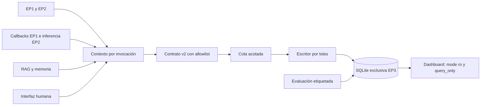

# EP3 — Arquitectura, modelo de datos y diccionario

## Arquitectura



La observación usa ContextVar, sin inyectar datos al prompt ni sustituir decisiones
del servidor. EP2 conserva su cerrojo, herramientas y restricciones. En EP1 se
observa el nodo LLM mediante callbacks y la cadena como otra frontera; no se suman
ambos errores como solicitudes. Se deduplican callbacks heredados del resumidor.
Cada intento LLM tiene solicitud_id_tecnica; cada bucle lógico tiene llamada_id.
Esos UUID son técnicos y no corresponden a una SolicitudConfirmacion humana.

## Modelo y compatibilidad

| Tabla | Contenido y clave |
|---|---|
| trazas | ejecucion_id, versión, pipeline, origen, sesión seudónima, categoría, correlación, clave_id y operación. |
| eventos | evento_id, ejecución, secuencia, UTC, componente, estado/código, duración y JSON validado. |
| evaluaciones | Referencia de ejecución, caso/variante, método, métrica, valor y muestras. Sin entradas o respuestas. |
| salud_telemetria | Snapshot acumulado por recolector de persistencia, pérdidas y fallas. |
| politica | retencion_dias; ventana de lectura, sin borrado. |

La BD usa user_version=2, application_id EP31. Acepta JSON v1 y v2. La migración
añade estructura y respalda v1; no convierte resultados históricos en mediciones
nuevas. Los esquemas v1 quedan conservados y se publican los JSON Schema v2 de
traza, evento y evaluación. No modificar un JSON de evidencia para fingir otra versión.

## Métricas

| Indicador | Fuente / cálculo | Unidad, denominador y límite |
|---|---|---|
| Consultas | consulta_fin | Solo invocaciones terminadas; confirmaciones/POSPONER se separan. |
| Éxito | estado ok / consultas finalizadas | Se informa n; pendiente, denegado y sin contexto no son errores HTTP. |
| Latencia | Duración monotónica en consulta_fin | ms; incluye memoria y cerrojo EP2, excluye espera humana y flush. |
| Promedio/P50/P95 | Duraciones presentes de la selección | n visible; percentil lineal sobre muestras ordenadas. Vacío = no disponible. |
| Herramientas | herramienta_fin | Duración inclusiva de controles y plan; estado/código sin argumentos. |
| Memoria | memoria_fin, etapa recuperar/guardar/historial | ms; la observación no hace una lectura adicional. |
| RAG | rag_fin | ms, método y cantidad devuelta; evita doble conteo cuando una entrada llama a otra. |
| Puntaje FAISS | puntaje_maximo | Solo semántico; identificador exacto = NULL, no score 1 inventado. |
| Solicitudes LLM | modelo_inicio, frontera llm | Intentos efectivos del modelo (simulados si así se declara); no decisiones locales. |
| Decisiones | decision | Puede existir cierre local sin solicitud LLM. |
| Reintentos | modelo_reintento por llamada_id | Espera prevista y espera_fin observada; llamada_fin acredita resultado definitivo. |
| Errores | modelo_error | HTTP y categoría cerrada; no mensajes, bodies ni excepciones crudas. |
| Tokens | usage_metadata o token_usage informado | Entrada/salida independientes; NULL si falta. No se calcula costo ni se estima uso real. |
| CPU | Diferencia process_time del proceso | ms; incluye otros hilos, no atribución exclusiva a una consulta. |
| RAM | Working set Windows o RSS /proc Linux | bytes, snapshots inicial/final; no pico por consulta ni solo heap Python. |
| Propuesta/confirmación | herramienta pendiente, confirmacion_fin, posponer | No contienen texto, huella ni ID de autorización. Reutilización no es inserción nueva. |
| Calidad de hechos | Comparación P2, primera respuesta 30 min y resolución 8 h | Referencias estructuradas del fixture, no evaluación generativa universal. |
| Acierto documental | Documento esperado entre fuentes / ausencia correcta | Objetivo documental, no relevancia etiquetada por fragmento. |
| Restricciones | Estado esperado, integridad, notas/auditoría y control humano | Booleanos por escenario; el origen simulado siempre se mantiene. |
| Consistencia | Firma técnica modal / variantes equivalentes | n por grupo; no comparación literal de respuestas ni fallas distintas. |

En el benchmark, `delta_ms=on_ms-off_ms`; `sobrecarga_pct=100*delta_ms/off_ms` por
par. Se publican media, P50/P95 y los pares sin recortar valores negativos.

## Salud y datos incompletos

Los contadores son emitidos, persistidos, descartados, pendientes, fallos_validacion,
fallos_almacenamiento y fallos_instrumentacion. El dashboard muestra salud global
del archivo; no la atribuye a los filtros de una sesión. Si el archivo no pudo
escribirse, puede haber contadores solo en RAM. Una traza sin fin no prueba éxito
ni fallo. Se omiten filas corruptas tras validación estricta y se informa su número.

Los filtros temporales pueden mostrar una parte de una traza. El lector limita a
50.000 eventos, avisa si recorta y nunca usa contenido inválido para gráficos.
Las bases vacías, desconocidas, bloqueadas o inaccesibles tienen mensajes técnicos
genéricos. Las filas de evaluación se separan por origen y se muestran con método.

## Consultas SQLite reproducibles (solo lectura)

Abrir con URI `file:.../observabilidad.db?mode=ro`, parámetro `uri=True`, y ejecutar
`PRAGMA query_only=ON`. El dashboard ya aplica ambos controles.

```sql
SELECT t.tipo_ejecucion, e.estado, COUNT(*) AS consultas
FROM eventos e JOIN trazas t USING(ejecucion_id)
WHERE e.evento='consulta_fin'
GROUP BY t.tipo_ejecucion,e.estado;

SELECT t.tipo_ejecucion,e.evento,e.codigo,COUNT(*) AS eventos
FROM eventos e JOIN trazas t USING(ejecucion_id)
WHERE e.evento IN ('modelo_error','modelo_reintento','llamada_fin')
GROUP BY t.tipo_ejecucion,e.evento,e.codigo;

SELECT secuencia,fecha_utc,evento,estado,codigo,duracion_ms
FROM eventos WHERE ejecucion_id=? ORDER BY secuencia;

SELECT tipo_ejecucion,caso,metrica,valor,contenido_json
FROM evaluaciones ORDER BY rowid;
```

No sumar latencias inclusivas de herramienta y RAG ni mezclar orígenes. Los
tokens solo son consumo informado del origen seleccionado; un dato simulado no
acredita facturación o saldo de una cuenta real.
